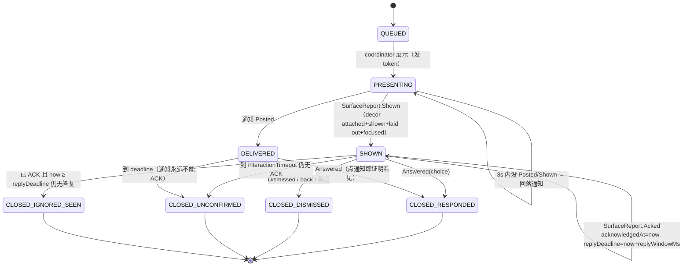
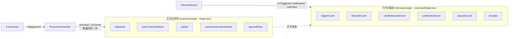
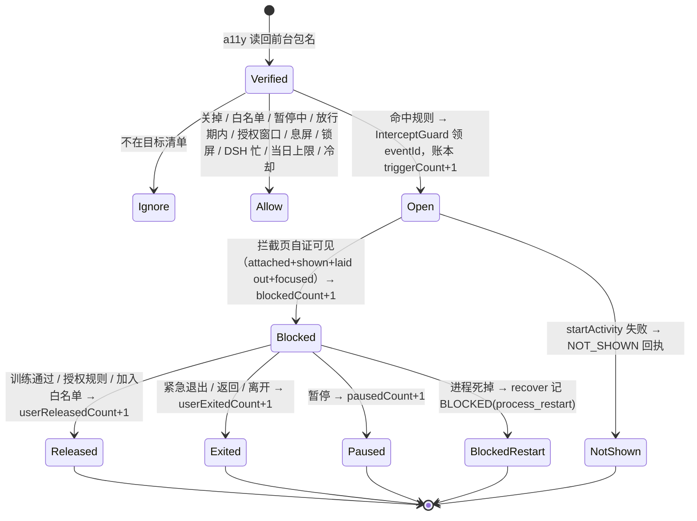

# R4 · 人工 ACK + 两本账 + 娱乐 APP 拦截（M1）

分支 `feat/r4-intercept-and-ack`，基线 R3 `f1423dc1`。

本轮三件事都落在 `loop/core`（纯 Kotlin，JVM 可测）与 `loop/proactive` / `loop/intercept`（Android 适配层）：

| 任务 | 内核（JVM 可测） | 适配层（Android） |
|---|---|---|
| 1 人工 ACK | `CoreModel.Engagement` / `SurfaceReport.Acked` / `ReplyWindow`；`Coordinator` 盖时间戳 | `ProactivePageActivity` 第三个按钮「我看到了」 |
| 2 两本账 | `Ledgers.kt`：`ProactiveLedgerBook` / `InterceptLedgerBook` | 各自一个 `AtomicJsonFile`，互不共享 |
| 3 娱乐拦截 | `Intercept.kt`：`InterceptRules` / `InterceptGuard` | `InterceptPageActivity` / `InterceptRuntime` / `InterceptPlugin` |

## 1. 「看见」与「忽略」是两件事

改动前 `ProactiveEvent.engagement` 只要 `shownAt != null` 就判 `IGNORED_SEEN` —— 页面被画出来就等于「看见了但没回」。
这是错的：页面被系统画上来不代表人看过（锁屏后启动、被立刻盖住、ROM 上根本没到前台）。
同时它让「累计 3 次未回 → 暂停主动搭话」这条链建立在一个不可靠的信号上。

现在只有**用户主动按「我看到了」**才算确认看见，且要**再过完整个回复窗口仍未回复**才算忽略。

### 状态转移（任务 1）

`engagement` 判定的顺序（`CoreModel.kt`，纯函数，重启后不变）：

| 序 | 条件 | Engagement | 调度器动作 |
|---|---|---|---|
| 1 | `outcome == RESPONDED` | RESPONDED | ignoredStreak=0，ackedStreak=0，解除暂停 |
| 2 | `outcome == DISMISSED` | DISMISSED | 同上（人主动关掉，不算沉默） |
| 3 | `acknowledgedAt == null` 且交过面 | UNCONFIRMED | 不加罚、不加分 |
| 4 | `acknowledgedAt != null` 且（还开着 或 关在 replyDeadline 之前） | ACKED | ackedStreak+1，**不**拉长间隔、**不**暂停 |
| 5 | 其余（ACK 了且窗口过完） | IGNORED_SEEN | ignoredStreak+1，按 ignoredBackoff 拉长，到 pauseAfterIgnored 暂停 |

`replyWindowMs` 是**内核策略**：`ReplyWindow.DEFAULT_MS = 20 分钟`，debug 构建 `DEBUG_MS = 60 秒`
（`ProactiveRuntime` 从 `ApplicationInfo.FLAG_DEBUGGABLE` 读）。页面不持有、不计算、不自带时间戳，
回执只带 token；`acknowledgedAt` / replyDeadline` 全部由 `Coordinator.onSurface(Acked)` 盖。

## 2. 两本独立账

只允许一个 `ignoredCount` 同时控制两条链路是明确禁止的。所以：

* 两个 `SnapshotStore` 文件、两个 `applied` 去重集合、两把锁。
* 幂等键：`ack:<eventId>` / `close:<eventId>` / `trigger:<eventId>` / `blocked:<eventId>` / `end:<eventId>`。
  同一 eventId 重复投递（重放回执、双指连点、崩溃后重放）都只算一次；`applied` 集合本身也随账本一起持久化。
* 崩溃恢复：`recover()` 与首次启动同一条代码路径；文件损坏 → `recoveryIssue = *_unreadable`（不假装是新账本）。
* 主动账由 `ProactiveScheduler` 唯一写入（它才知道 engagement 对调度的含义）；拦截账由 `InterceptGuard` 唯一写入。

## 3. 娱乐 APP 拦截最小闭环

* 目标包名清单 `InterceptConfig.targets` 可配置（默认 B站/抖音/快手/小红书/抖音极速版），白名单 `whitelist`、
  暂停 `pauseUntilWall`、放行时长 `releaseMs`、训练时长 `trainingMs`、冷却 `cooldownMs`、每日上限 `dailyMax`、
  授权规则窗口 `authorizedWindows`。
* 一次只拦一个（`openEventId` 单槽）；同一 app 短时间内不重复拦截（冷却）；删除目标会当场关掉它的页面。
* 拦截页有五个出口：训练通过、授权规则、加入白名单、暂停、紧急退出 —— 全部落到拦截账。
* 拦截不经过 `Coordinator`，也不经过 `ProactiveScheduler`：没有第二套调度器、没有第二个 TriggerBudget。

## 4. 与既有链路的接缝

* `Switches` 增加 `intercept` 一位，只用来决定「要不要读前台」；它不参与 `disabledSources()`（拦截没有 coordinator 事件）。
* `LoopRuntime.verifyNow` 在**已经验证过的包名**上先喂给拦截，再走原有的 app-enter 触发；两条链路各自记账。
* `ProactiveRuntime.onSurface` 收到 `Acked` 时调 `scheduler.onAcked`，**不**调 `onUserActivity`
  （确认看见 ≠ 回应，不该像回应那样把下一次搭话推后）。

## 5. 未完成 / 未验证

见提交说明的「未完成功能清单」。要点：真机与 APK 一律 NOT_TESTED（本机 adb 0 台、WSL 挂死），
Flutter 设置页只做了回执文案的 ACKED 映射，拦截配置页尚无 Dart UI（通道 `dsh/intercept` 已就绪）。
