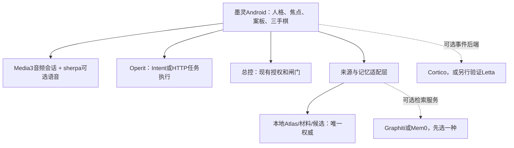

# 墨灵：开源复用调研与选型建议（2026-10-22）

目标：更强的实质能力、连续记忆、自然的主动陪伴与语音表现，减少重复建设。调研以项目官方README、源码、接口文档和许可证为据；本轮没有安装或编译第三方项目，没有在真机跑集成，以下“可接入”是待验证的工程判断，不是已验证兼容性。

本报告只提供复用依据和最小验证路线，不更改现有第十至十三批任务范围，也不把新候选项目加入生产依赖。

## 1. 结论：先买齐零件，再决定换不换底座

优先看 **Muse（Android陪伴/记忆）、Operit（Android执行宿主）、Media3+sherpa-onnx（原生语音基础）**。持续人格/事件循环参考 **Cortico**，表现参考 **AIRI**；“夜间反刍”参考 **Letta Code**，需要更复杂的时间知识图时再试 **Graphiti**。

主记忆保留一处，本地Atlas/案板仍是权威。不要同时引入Muse记忆、Mem0、Graphiti、MemOS与Letta，让五套系统分别解释“你是谁”。先选一条增强路径，通过适配器输出可审阅的候选和来源。

可行的部署形态：

Operit的执行权限与总控权限不会天然共享。通用文件/网页/工具任务可以试交给Operit；放行、收紧、计划执行继续走总控协议。外部服务失败时本地案板、已存记忆与点选陪练仍应可用。

## 2. 最值得采用的项目

| 项目 | 官方实现与本项目收益 | 复用方式 | 栈、部署与许可证 |
|---|---|---|---|
| [Muse](https://github.com/Zer0Qing/Muse) | Android本地四层记忆、来源追溯、摘要编译、反思、主动消息评分/间隔、夜间处理、多助手 | 同栈的首要参考；先体验和对比，再提取明确模块或独立实现其机制 | Kotlin/Compose/Room；GPLv3；项目较新，未验证稳定性，不能以README功能表代替测试 |
| [Operit](https://github.com/AAswordman/Operit) | Android工具执行、工作流、系统能力、网页/文件/终端、记忆和角色；已有外部请求/回传协议 | **优先以独立App执行器集成**；先用Intent/HTTP验证请求和结果，不整仓复制 | Kotlin/Android；主代码LGPL-3.0-only，工具/依赖另查；部分能力依赖所选系统权限 |
| [Cortico](https://github.com/Pal-AI-Lab/Cortico) | 事件流、持续session、Persona/Memory/World分层、idle与后台认知钩子；贴近持续伙伴的组织方式 | 参考统一循环或作为PC/服务器上的可选脑后端；Android做World适配 | TypeScript/Node；MIT；并非原生Android库，不应直接塞进APK |
| [AIRI](https://github.com/moeru-ai/airi) | 语音输入/识别/合成、VRM/Live2D表情与动作、角色呈现 | 表现与语音事件的参考，或单独试用验证“在场感” | TypeScript/Web/桌面；有Pocket移动开发，但不能等同于完整原生Android后台能力；主代码MIT |
| [sherpa-onnx](https://github.com/k2-fsa/sherpa-onnx) | Android/Kotlin支持、离线ASR/TTS/VAD及示例APK；减少语音底层重写 | 用官方Android样例做小模块，再接现有Voice/Speaker端口 | C++/Java/Kotlin/JNI；Apache-2.0；所选模型授权、体积、中文效果和手机耗电需分别验证 |
| [AndroidX Media3](https://github.com/androidx/media) | Android媒体播放与会话基础，为电台/音场的播放、暂停、通知和生命周期提供成熟组件 | 直接Maven依赖，仅接需要模块；自有TTS/ASR仍由会话协调器管理 | Android原生库；Apache-2.0；不能包办ASR、回声消除或任意控制其他App音量 |
| [Graphiti](https://github.com/getzep/graphiti) | 时间事实、episode来源、冲突后的历史保留、关键词/语义/图遍历混合检索 | 高级Atlas能力的可选服务；优先验证可追溯检索，不替换整个本地库 | Python+支持的图存储，REST/MCP参考服务；Apache-2.0；需部署、模型及embedding配置 |
| [Letta Code](https://github.com/letta-ai/letta-code) | 持续身份/记忆、版本化MemFS、主动运行、dream/reflect和调度 | “反刍/经验沉淀”的机制参考或独立后端试验，不直接接管总控 | TypeScript/agent harness；Apache-2.0；部分功能有账户/云端依赖，需核对具体路径 |

### Muse：与墨灵最接近的Android参考

不止是README画概念，检查到了实际文件与对应测试目录：
- [主动消息评分](https://github.com/Zer0Qing/Muse/blob/938a56aa4c3d92b377375bafbb1cf4ef53883b2d/app/src/main/java/io/zer0/muse/data/proactive/ProactiveScoreEngine.kt)：按上下文评分，结合安静时段与每日额度，不是简单“每分钟叫一次”。
- [主动程度档位](https://github.com/Zer0Qing/Muse/blob/938a56aa4c3d92b377375bafbb1cf4ef53883b2d/app/src/main/java/io/zer0/muse/data/proactive/ProactivePace.kt)：用户表达想多主动，底层再映射间隔/概率/数量。
- [记忆反思运行器](https://github.com/Zer0Qing/Muse/blob/938a56aa4c3d92b377375bafbb1cf4ef53883b2d/memory/src/main/java/io/zer0/memory/reflection/MemoryReflectionRunner.kt)。
- [实际记忆流水线说明](https://github.com/Zer0Qing/Muse/blob/938a56aa4c3d92b377375bafbb1cf4ef53883b2d/app/src/main/assets/devdocs/long_term_memory_guide.md)：对话→原子事实→滚动摘要→深度处理→摘要注入，含重要记忆保护与作用域隔离。
- [记忆编译器](https://github.com/Zer0Qing/Muse/blob/938a56aa4c3d92b377375bafbb1cf4ef53883b2d/memory/src/main/java/io/zer0/memory/compile/MemoryCompiler.kt)及memory模块下的迁移/来源/去重测试。

这些最适合补W10的CognitiveProfile/主动准备及未来反刍。不要复制整个大型Runner或所有UI；先从一个行为和一种数据结构起步。GPLv3源码复用前需确定墨灵分发许可证；调研、试用和机制参考与复制代码是不同的事情。

### Operit：有文档化外部接口，优先做这个桥

已核对官方文档：
- [Intent外部聊天及回传](https://github.com/AAswordman/Operit/blob/dbf71916fae9750cfdc9f9a774f5a0fee56633fb/docs/doc-src/feature-protocol/external_intent_chat.md)：入口 `com.ai.assistance.operit.EXTERNAL_CHAT`，有request_id、chat_id、reply_action/reply_package和结果。
- [HTTP接口](https://github.com/AAswordman/Operit/blob/dbf71916fae9750cfdc9f9a774f5a0fee56633fb/docs/doc-src/feature-protocol/external_http_chat.md)：可选开启，Bearer鉴权，含health、external-chat，同步/SSE/异步回调。
- [Intent触发工作流](https://github.com/AAswordman/Operit/blob/dbf71916fae9750cfdc9f9a774f5a0fee56633fb/docs/doc-src/feature-protocol/workflow_intent_trigger.md)：可绑定指定工作流与结果回传。

建议实现一个OperitActorBridge：墨灵准备焦点/任务→显式调用→按request_id收回→落ACTOR_RESULT案板。先做“公开网页整理/文件资料包”等受控任务，再考虑更多动作。

回传广播指定目标包还不等于已验证发送者身份。需要核查实际接收器的访问/认证机制、关联未完成请求、校验结果归属；外部聊天文本中的“已完成”不自动当作系统执行凭证。HTTP的异步回调文档说明失败不自动补发，墨灵必须处理超时/结果未知，而非无限重发。

尚未验证：当前发行APK是否包含与源码文档一致的接口、同机后台调用与进程存活、工具权限/用户确认如何影响请求结果。这正是最小实验要测的内容。

### Cortico/AIRI：把持续在场与外观分开

Cortico的 [Persona契约](https://github.com/Pal-AI-Lab/Cortico/blob/02682f69065dfaa4d9ff9a4b25a8f8e67ba006e7/docs/personas.md) 已有onIdle/onTurnEnded/后台认知与session头部上下文等扩展点；[World契约](https://github.com/Pal-AI-Lab/Cortico/blob/02682f69065dfaa4d9ff9a4b25a8f8e67ba006e7/docs/worlds.md)把环境事件和工具回执与主记忆隔离。适合参考墨灵统一循环，避免每个功能各自轮询、各自改记忆。

AIRI已经有语音和模型动作；但当前 [README路线图](https://github.com/moeru-ai/airi/blob/44d1825e61f39133f202c64928c576caaaa6f117/README.md)中的Memory/Alaya仍有未完成项。它是表现与互动的强参考，不能据此宣称长期记忆已经完整。Pocket说明主要展示iOS/Capacitor开发；Web/PWA能运行也不等于能承担vivo后台、总控Provider和Android悬浮权限。

### Graphiti/Letta：解决长时间连续性，不承诺“生命”

Graphiti适合“过去这样，现在改变了”的时间知识与来源：旧事实失效后保留历史，不直接删除。它不是一个能直接导入Kotlin的轻量库；现有README建议Neo4j/FalkorDB等图存储，Kuzu已标弃用，不能拿旧教程当新选型。

Letta当前 `letta-ai/letta` README已指向 `letta-ai/letta-code`；评估应使用新实际源码。dreaming是后台反思作业，不是模型生物睡眠，也不保证自动得到正确洞察。接入时只返回候选/摘要，用户偏好、事实改写、总控授权各走现有验证路径。

## 3. 其他候选及暂不采用的理由

| 项目 | 可以借什么 | 当前处理 |
|---|---|---|
| [Mem0](https://github.com/mem0ai/mem0) | 用户/会话/agent记忆、抽取/搜索/更新，Python/JS和服务路径 | 作为Graphiti的替代试验，二选一。当前README明确一些benchmark对应托管平台的专有优化，不能把数字当开源SDK保证 |
| [MemOS](https://github.com/MemTensor/MemOS) | 图式可编辑记忆、异步摄取、反馈修正、local plugin | 关注；服务版与OpenClaw/Hermes/DSH插件不是同一种部署，插件不能直接当Android库 |
| [Pipecat](https://github.com/pipecat-ai/pipecat) + [Android Client](https://github.com/pipecat-ai/pipecat-client-android) | 实时语音管线、轮次/中断/工具协调，已有Kotlin客户端 | 需要服务端/相应transport时采用；基础client不自带transport。无需为了目前简单电台就引入整套服务器 |
| [Open-LLM-VTuber](https://github.com/Open-LLM-VTuber/Open-LLM-VTuber) | 语音打断、主动说话、Live2D表现，可独立试用 | 适合体验标杆；主要桌面/Python体系，模型素材与主代码授权分开 |
| [Coopanion](https://github.com/Pal-AI-Lab/Coopanion) | 桌宠生活感、人格/伙伴文档、版本化共同记忆，基于Cortico | 当前AGPL-3.0-or-later含额外许可，MIT只到早期0.1.10；别按旧记录复制当前代码，图像素材另有条款 |
| [OhMyAgent](https://github.com/tscodeplus/OhMyAgent) | [DreamCycle](https://github.com/tscodeplus/OhMyAgent/blob/main/src/memory/dream-cycle.ts)：分阶段整理、去重、冲突保留、维护账本 | MIT，Node/Termux；小型新项目，适合读实现与测试，不作为已成熟底座推荐 |
| [Andee](https://github.com/kuafuai/andee) | Android无障碍执行、角色和调度的实现参考 | [LICENSE](https://github.com/kuafuai/andee/blob/main/LICENSE)不是标准Apache-2.0，含产品嵌入需书面授权等附加条件；不列为可直接抄模块的候选 |
| [operit-mcp-bridge](https://github.com/jay52121/operit-mcp-bridge) | 请求/结果桥的MVP结构 | README写明Worker还有adapter placeholders；没有明确标准许可证。优先使用Operit官方接口，不能把该MVP当现成可用手机执行服务 |

## 4. 三个验证实验，先用结果决定复用

这些是验证建议，不是本轮已运行结果，不新开一套第十四批功能清单。

### P-A：声音连续性（直接依赖）

用Media3管理电台音频/背景音的播放会话；系统TTS可继续保留。需要离线语音/VAD时用sherpa官方Android样例与一种模型。跑：播放→用户显式语音插话→暂停→回复→恢复→停止；来电/拔耳机/锁屏/旧回调也不残留声音。

输出实测延迟、包体增量、CPU/耗电、中文效果。若原生SpeechRecognizer足够稳定，就先不引入本地大模型。Media3不替代TTS/ASR和会话仲裁，不应误以为加依赖就能完成W11。

### P-B：Operit执行桥（外部宿主）

选一个现有可核验只读任务，携带request_id发给Operit。返回内容落到同一focusId的案板并保留来源。测试超时、取消、Operit未安装/未启用接口、重复结果和用户拒绝工具执行；先不包含总控放宽/训练通行。

成功后可替代部分W10抓取/工具代工和W12执行通路，保留独立接口契约与白名单；是否交付成功以实际产物/工具回执为准。验证失败时退回自有适配器，不让全部主流程依赖另一App。

### P-C：长期记忆与主动性（同栈参考，选单一实现）

优先对照Muse的本地模块，或单独部署Graphiti试验。用一组固定案例：偏好变更、同名不同人、矛盾信息、撤销事实、来源删除、影子角色虚构台词、重要记忆置顶。检验检索/来源/纠错，不只看聊天是否顺口。

主动消息只借一个评分/冷却/新鲜度机制，接已有Cycle和预算。后台反刍先生成待核洞察/修剪提案，不自动删除Atlas或把角色表演当事实。

## 5. 对当前第十至十三批的替换建议

- W10 T6/T8：先读Muse记忆与主动模块，比较复用成本；高级检索选Graphiti或Mem0一种服务试验。
- W10 T4/T5：Operit可承担明确工具子任务；来源真实性与案板引用校验仍由墨灵负责。
- W11 R1/R6：优先Media3/系统音频API，按需sherpa；需要完整实时语音后端才选Pipecat。
- W12 A1–A3：已有Actor会话模型保留，新增Operit端点验证；Cortico可选作事件脑，不与当前主脑同时抢记忆写权。
- W12 A4与W13：Android采集、总控授权、训练兑换不会因接上外部框架自动完成；实际协议/权限/验证仍需接线。
- 五个生命系统：Muse/Letta/OhMyAgent可提供反刍与维护机制；共同战役史仍需从墨灵自己的真实artifact/decision/event生成。

## 6. 许可证与维护边界

本仓库当前API未识别到明确项目LICENSE。复制GPL/LGPL代码、链接第三方库、独立服务调用有不同要求；先记录所选版本和许可证，不能把所有GitHub项目当MIT代码。此调研不自动给墨灵改许可证，也不替第三方素材/模型补授权。

候选存在测试目录不代表本轮跑过测试；项目近期有提交也不代表稳定。锁定版本后，要检查所选模块依赖、迁移、崩溃恢复与目标手机表现。暂不把多个大型agent框架一起塞入现有工程。

## 7. 本轮核对的版本

| 项目 | 检查分支 | SHA | 主代码许可（核对时） |
|---|---|---|---|
| [Zer0Qing/Muse](https://github.com/Zer0Qing/Muse) | main | `938a56aa4c3d92b377375bafbb1cf4ef53883b2d` | GPL-3.0 |
| [AAswordman/Operit](https://github.com/AAswordman/Operit) | main | `dbf71916fae9750cfdc9f9a774f5a0fee56633fb` | LGPL-3.0-only |
| [Pal-AI-Lab/Cortico](https://github.com/Pal-AI-Lab/Cortico) | main | `02682f69065dfaa4d9ff9a4b25a8f8e67ba006e7` | MIT |
| [Pal-AI-Lab/Coopanion](https://github.com/Pal-AI-Lab/Coopanion) | main | `f30ab6b6ca0fd17e4a66ce290dbec76839ea6399` | AGPL-3.0-or-later + exception |
| [moeru-ai/airi](https://github.com/moeru-ai/airi) | main | `44d1825e61f39133f202c64928c576caaaa6f117` | MIT |
| [getzep/graphiti](https://github.com/getzep/graphiti) | main | `8e320f880e7d169a907dbf2a7ac4188586c03b55` | Apache-2.0 |
| [k2-fsa/sherpa-onnx](https://github.com/k2-fsa/sherpa-onnx) | master | `96bdb8ebc7dc1add7f11074be41316b9e8779731` | Apache-2.0 |
| [letta-ai/letta-code](https://github.com/letta-ai/letta-code) | main | `734627d7ea066fd207eacc82bed6075f194f275d` | Apache-2.0 |
| [androidx/media](https://github.com/androidx/media) | release | `8c6678b657ede1e7883fc164ef73ed483c7796c3` | Apache-2.0 |

给后续编码AI：先读本报告，给出P-A/P-B/P-C中一条最小验证分支及结果；先核查接口/许可/适配成本，不整仓换底座。现有未完成任务按真实接线与测试结果更新，不能因为找到一个开源框架就勾选全部完成。
