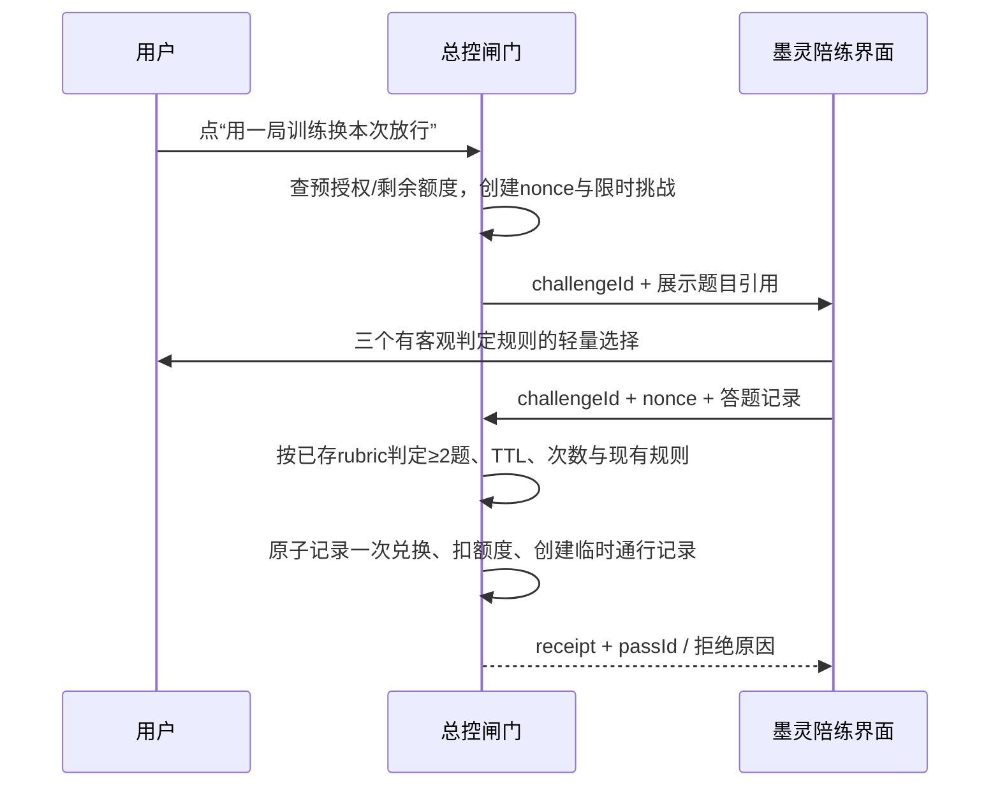

# v13 契约、跨进程协议与数据归属

配套：[总设计](v13-system-blueprint.md) · [完整 Kotlin 定义](v13/V13Contracts.kt) · [实施与验收](v13-delivery.md)。此处定义目标接口，当前 App 还没有实现这些 v2 方法。

## 1. 模块边界与可编译模型

`v13/V13Contracts.kt` 是无 Android 依赖、可单独编译的完整 DTO/接口定义；不包含网络、数据库和 UI 实现。实现阶段把模型按下表移入生产模块，添加显式序列化名、字段限制与 codec；不能直接把整个文件复制进 Brain.kt。

| 脑/手 | Kotlin 定义 | 生产位置（相对 com/moling/） |
|---|---|---|
| B1/H2 | SourceRef、AttentionEvidence、CaptureLease、ScreenSnapshot、InhaleItem/Buffer、WebPort | core/intake、core/web；Android 采集/网络放 app/intake、app/web |
| B2 | FocusWorkspace、MemoryCandidate、RecallRequest/Bundle、MemoryPort | core/workspace、core/atlas；数据库适配 app/workspace |
| B3/H3 | WorkspaceArtifact、ArtifactBlock/Option/Action、WorkspacePort、PreworkJob、CouncilReview | core/workspace、core/strategy |
| B4 | IgnitionTurn、QuickChoice、ThreeTurnChess | core/spar 的只读/传输投影；现有 Chess 是唯一游戏引擎 |
| B5 | ChoiceBet、BetOutcome | core/predict；不替换原行为预测 Metric |
| B6/H4 | CognitiveProfile、Exposure、ModalityStats、HabituationTracker、GlitchKind、RadioSession、VoiceSession | core/live、core/review；app/live、app/voice |
| B7/H1 | ActorBridge、ActorPayload/Target/Session/Result | core/actor；app/actor 连接 Presence/RelaySync/模型 API |
| B7/H5 | FlowAdoption/OptOutPolicy、CognitiveUnlockPolicy/Challenge、UnlockSubmission、TemporaryPass、GateV2Port | core/flow、core/link；挑战、授权和令牌主账本属于总控 |
| 协同层 | CycleEvent/Decision、CognitiveCycle、BrainV13State、AutonomyBudget | core/cycle；app/cycle 调度与事务/outbox |

旧名的处理：`FOG_BREAKER`映射 `TalkMode.FOG`；`THREE_TURN_CHESS`映射现有 Chess/Chesses；`quickChoices`是现有 `choices` 的类型化投影；HabituationTracker 包装并逐步扩展 Habits；RADIO 是长期呈现会话；BrainV13State 是现有 BrainState 的可选扩展，不替换整个旧状态。

`SourceRef` 的真实 URL/片段与可验证状态是引用事实的依据。ID 不能由模型随意新增或指向不存在对象。ArtifactAction 必须带 expectedRevision，冲突返回 REVISION_CONFLICT 并允许重新批阅；重复 action.id 返回同一结果。外部结果只能提出候选，不直接调用 MemoryPort.accept。

## 2. 本地存储与事务

现有 BrainState JSON 中只加可缺省的 v13 扩展和对象 ID。大文本与来源移到独立的本地事务数据库：

| 表/集合 | 唯一键与关系 | 保留/删除 |
|---|---|---|
| sources、inhale_items | sourceId、contentHash；消费记录按 jobId | 临时原文默认 24h；被采用引用跟随 Artifact；清除时可保留无原文的来源壳 |
| focus_workspaces | focusId、revision；一个 ACTIVE | 两小时转归档，不删除成果 |
| artifacts、artifact_revisions、artifact_actions | artifactId+revision；actionId幂等 | 有版本历史；删除显式影响引用，不静默改变已采纳知识 |
| jobs、cycle_events | jobId；focusId+inputHash+deliverable 去重 | 每次状态转换有事件；过期/被替代结果仍可查看但不覆盖 |
| actor_sessions、actor_results | sessionId；sessionId+contentHash 去重 | 会话撤销后停止捕获；未收线可以稍后恢复 |
| profile_exposures、outbox | exposureId；operationId | 统计保留聚合；同步完成标记，不重复写外部页面 |

数据库事务原子提交“作业完成+Artifact新版本+事件+同步outbox”。JSON 中对象 ID 只是缓存指针；启动时以数据库提交版本重建它，避免双写崩溃产生幽灵草稿。网络请求使用不可变输入快照，在锁外完成；提交时核对焦点和版本。

## 3. 墨灵 ↔ 总控：兼容 v1 的 Provider 扩展

保留 authority `com.zongkong.app.moling` 和 v1 的 status/command/result、所有 Bundle 字符串字段。**不把 ZK_LINK_VERSION 从 1 直接改成 2**。先调用独立 `v2.capabilities`；旧版返回未知方法时只使用 v1，不发送新命令。

延续实际调用方校验：Binder UID 对应包名必须是 `com.moling.app`，并验证固定签名证书。不能接受 Bundle 中自报的 package/uid。先校验调用方，再读 payload；Provider 不在主线程做网络、解析整页或运行模型。

v2 仍使用 `ContentResolver.call(uri, method, null, Bundle)`。Bundle 只有 `version`、`requestId`、`payload` 等受限字符串；payload 是契约 JSON，不传 Android View/AccessibilityNodeInfo 对象，不传可执行 Intent。示意：

```json
{
  "version": 2,
  "requestId": "req-unique-001",
  "method": "v2.capture.begin",
  "sessionId": "actor-session-1",
  "createdAt": 1792590000000,
  "expiresAt": 1792590120000,
  "payloadJson": "{\"id\":\"lease-1\",\"packageNames\":[\"selected.package\"],\"mode\":\"TITLE_ONLY\",\"userStartedAt\":1792590000000,\"expiresAt\":1792590120000,\"maxChars\":8192,\"allowCoordinates\":false}"
}
```

| 方法 | 请求负载 | 响应/语义 |
|---|---|---|
| v2.capabilities | 空对象 | 支持的版本、采集渠道、节点是否可读、训练协议、限制；不是权限授予 |
| v2.capture.begin | CaptureLease | 总控核对用户开启的采集范围后返回有效租约；请求不能扩展用户选择 |
| v2.capture.poll | leaseId、cursor、limit≤4 | SnapshotBatch；最多 32 KiB UTF-8，超出分页；gap=true表示漏页，不假造连续记录 |
| v2.capture.end | leaseId | 立即停止并丢弃待处理快照；重复结束成功 |
| v2.challenge.issue | policyId、packageName、requestId | ChallengeBundle（挑战+题干/选项）；判分表只在总控侧 |
| v2.challenge.submit | UnlockSubmission | ExecutionReceipt，可能包含总控生成的 TemporaryPass |
| v2.receipt | requestId | 上次稳定结果；重复请求不能再发一次放行 |

错误码固定：UNSUPPORTED_VERSION、CALLER_REJECTED、SCOPE_DENIED、EXPIRED、RATE_LIMITED、PAYLOAD_TOO_LARGE、REVISION_CONFLICT、NOT_AVAILABLE、REPLAY、POLICY_DENIED。响应不返回敏感原文或堆栈。TTL 使用系统时钟但辅以单调计时核验短会话；时钟倒退时拒绝执行型旧请求并要求新建请求。

### 3.1 屏幕“DOM”、坐标与剪贴板

Android 无障碍节点不等于浏览器 DOM。ScreenSnapshot 只传当前可见、所选范围内的扁平节点树（id/parentId/role/text，可选 bounds），最多 64 节点、8192 字符。无关输入框、密码、通知、支付/认证页面不入库；捕获应用切换到范围之外立即停止本次抽帧。

坐标带 displayWidth/height/rotation/windowRevision；超过 2 秒、窗口变更或旋转后视为失效。仅允许墨灵计算自身 HUD 位置，不能把旧坐标变成跨应用自动点击。高频区域推测只在实际收到相应事件时存在，不能从使用时长伪造手指坐标。

剪贴板不通过 Provider 轮询。用户在墨灵/收线界面点“粘贴”后，读取一次文本生成 USER_PASTE 材料。进场包写入剪贴板由启动外脑的明确动作触发；若已开启所选 Actor 的辅助填入，优先 ACTION_SET_TEXT，失败则提示用户粘贴，不循环抢焦点、不自动点击发送。

### 3.2 条件放行：由总控发行，不由墨灵签自己的分数

用户在总控显式启用 CognitiveUnlockPolicy，设置应用、可用额度、每日次数。15 分钟是可以选择的上限示例，不是新赠额度；单次可用时长取策略、当天剩余可用娱乐、总控其他约束的最小值。硬性禁用/严格期不可被普通训练令绕过；改变这些规则走既有规则修改流程与冷静期。

流程：



自由讨论版三手棋的模型评分仅做显示；兑换版需要总控持有、题目发布后不可更改的客观 rubric。无法生成可验证题目时降级为普通陪练，不假装发出临时令。passId 是总控数据库中一次性记录的索引，绑定包名、策略修订、截止时间、challengeId；不把本地字符串当签名。重复 submit 返回原回执而不重复扣款/发令。nonce 错误、答案越界、挑战撤销、过期、并发兑换只成功一次都有单元测试。

## 4. 外脑与 Web：同一任务格式，多种传输

ActorBridge 的四条路径：MODEL_API（用户配置凭据）、RELAY_MCP（外脑主动调用联络站工具）、官方 App 分享/粘贴回流、限定会话可见文本辅助。传输差异不改变 ActorPayload/Result，结果统一进入收件箱。

进场包的文本头尾带 sessionId、focusId、payloadHash、返回格式。新结果匹配明确 sessionId；只有一个未结束会话可默认建议归属，有多个时给点选，不凭时间强行归属。旁听得到的 visible partial 文本只作为片段，流式重复按 hash/turn标识去重；切出应用不等于外脑完成生成。完成后先形成 Artifact，再抽取待核知识。

Intent：ACTION_SEND 使用 text/plain 与 EXTRA_TEXT，必要文件通过 FileProvider content URI 加临时读权限；不广播整份知识库。回流优先复用现有 ShareActivity，不要求外部 App 提供并不存在的自定义回调。模型/联络站凭据属于各自适配器，界面和日志只显示配置状态。

WebPort 第一版选一个带用户配置密钥的搜索适配器（建议 Brave Search），另实现 RSS 与普通 HTML 正文读取；Jina Reader 为可选正文转换适配器，不当作免密、无限配额搜索。未配置搜索时 RSS/用户分享继续可用，Search capability 返回 NOT_CONFIGURED，不编造结果。实现时核对所选服务当前接口、额度和使用要求。

请求限 http(s) 公网目标，默认 https；拒绝本机/内网/元数据地址和跳转到这些地址，限制最多三次重定向、2 MB 响应、15 秒请求、总任务截止时间。缓存按 URL规范化+内容hash，引用保留原站 URL。RSS及读者正文需要更新时查缓存，不每次心跳重复抓取。

## 5. 系统环境与音频

日历读取独立请求 READ_CALENDAR；写入优先 ACTION_INSERT 打开系统编辑页，用户保存。直接后台写入需要另启 WRITE_CALENDAR 能力与授权。勿扰需要系统通知策略访问且设备支持，失败只提示未生效；歌单以显式 Intent 打开用户所选音乐 App，无法识别 URI 时提供配置入口。

音频由 AudioSessionController 持有唯一会话，使用系统音频焦点请求临时 duck，结束/取消/错误都释放。设备不支持 duck 或通话占用时延后，不强制改媒体音量。TTS完成后仅在仍有效的显式 VoiceSession 中启动 ASR；停止、锁屏退出该会话、权限撤销均取消监听。云端 TTS 是可选适配器，原生TTS是基本通路。

## 6. 容错、迁移与兼容

旧用户升级默认没有新的屏幕采集、电台自动续播、计划代驾、训练兑换授权；原聊天、总控连接、分享回流继续工作。新功能显示清晰入口，由用户选择启动，不用一张“全开”页捆绑权限。

迁移先导出旧备份与校验值，事务建新表和索引，保留原 Atlas/Chess/HabitBook/Baton ID。先读新库，尚未迁移则兼容读旧对象；成功迁移有版本标记，不能每次启动重复导入。备份 v13 扩展独立清单，不导出 API 密钥、短期 pass、租约或会话凭据。回退旧 APK 前提示先导出，不能声称未知字段的旧版一定无损恢复新数据。

每个新增能力有开关和版本协商；撤销会话立即停止采集/语音/待执行动作。Provider失联则案板留存、本地陪练可用；模型失联仍能阅读编辑资料并使用本地破雾选项；Web失联说明缺来源；Notion失联只影响归档。
