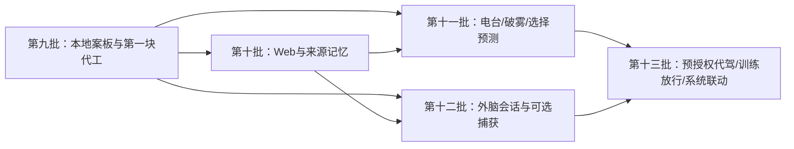

# v13 实施分解、文件映射与验收

总设计：[七脑五手](v13-system-blueprint.md)。协议：[契约与跨进程](v13-contracts.md)。模型：[完整 Kotlin](v13/V13Contracts.kt)。

## 1. 施工方式：统一架构，逐个闭环交付

这不是对全部旧文件同时做一次不可回退的重写。全局目标一次定义；按共同的数据契约、调度器和工作台逐步接通。保留当前可用版本，每波有独立入口、迁移和端到端验收。第八批发布修复独立完成，不与本计划混成一个 PR。

不依赖特定厂商模型有余额。核心任务 C、App 任务 I、总控任务 Z 以职责和文件边界分工，承担该任务的编码 AI 均可实现。旧 CODEX 的“界面任务不动 core”继续适用；有明确内核范围的 C/Z 任务独立提交规则与测试，不在 UI 提交中顺手放宽总控。

## 2. 依赖与批次



| 波次 | 交付物 | 覆盖七脑/五手 | 明确出口 |
|---|---|---|---|
| W1 / 第九批 | 焦点、案板、版本、第一块代工、内容参谋、统一破雾入口 | B2/B3/B4，H3 | 用户给材料后能点选改出一份可采用的稿子；无网络仍能读改 |
| W2 / 第十批 | 一个真实搜索适配器、RSS/正文、来源链、检索扩展、效用画像 | B1/B2/B3，H2/H3 | 分享链接→查证→带引用的资料/反例→待核知识 |
| W3 / 第十一批 | 电台、桌宠轮盘、反免疫效用、选择赌局、语音会话 | B4/B5/B6，H4 | 用户只听不回也能持续跟上一个问题；静音/停止/拒绝都生效 |
| W4 / 第十二批 | ActorBridge、sessionId回流、选定会话文本探针、Provider采集扩展 | B1/B7，H1/H2/H4 | 外脑进场→锚定→结果回案板；不支持读屏时完整降级 |
| W5 / 第十三批 | 计划采用状态、预授权执行、客观训练兑换、日历/勿扰/歌单 | B5/B7，H5 | 自动本地计划与总控执行状态分明；兑换不能重放、越额或绕过硬规则 |

每波从工作分支最新提交开分支，合入后再开下一波。W3/W4虽可在不同文件推进，但必须包含 W1 契约与已合入修订；不要用旧分支覆盖手机上的共享 APK。

## 3. 修改与新增文件全表

路径相对 `moling/app/src/main/java/com/moling/`，除标注 Z 的总控路径。下面是目标模块位置，新增文件不代表当前已经存在。确实需要拆文件时保留公共适配入口，并在 DEVLOG 记录映射。

| 区域 | 修改现有文件 | 新增文件/职责 |
|---|---|---|
| B1 感知 | app/HeartService.kt、app/BrainHost.kt、app/Usage.kt、app/ShareActivity.kt | core/intake/{SourceRef,InhaleBuffer,AttentionEvidence}.kt；core/web/WebPort.kt；app/intake/{IntakeRepository,ShareResolver}.kt；app/web/{SearchWebPort,RssReader,ArticleReader}.kt |
| B2 记忆 | core/atlas/{Atlas,Graph}.kt、core/think/Think.kt中的Recall、core/review/{Review,Rules}.kt | core/workspace/FocusWorkspace.kt；core/atlas/{MemoryCandidate,HybridRecall}.kt；core/review/CognitiveProfile.kt；app/workspace/{WorkspaceDatabase,WorkspaceRepository,WorkspaceMigration}.kt |
| B3 代工 | core/Brain.kt、core/think/Think.kt、core/mind/Reason.kt、core/review/Review.kt | core/strategy/{PreworkJob,PreworkPlanner,ContentCouncil}.kt；core/workspace/{WorkspaceArtifact,ArtifactAction}.kt；core/cycle/{CycleEvent,CognitiveCycle}.kt；app/cycle/{CycleRunner,JobWorker}.kt |
| B4 点火 | core/talk/{Modes,Talk}.kt、core/live/Live.kt、core/spar/Spar.kt、app/live/LiveScreens.kt、app/ui/{ChatScreen,ChessBits}.kt | core/spar/IgnitionPolicy.kt；app/ui/MaterialChoiceSheet.kt；类型化QuickChoice适配，不复制Chess引擎 |
| B5 博弈 | core/predict/Predict.kt、core/watch/Watch.kt、core/power/Powers.kt（仅能力适配；不放宽规则） | core/predict/{ChoiceBet,ChoiceBetSettlement}.kt；app/ui/BetCard.kt |
| B6 人格 | core/live/{Live,Habit}.kt、app/live/{PetOverlay,Whisper,Appear}.kt、app/ui/Speaker.kt | core/live/{PresenceDecision,RadioSession}.kt；app/live/{RadioController,PresencePolicy}.kt；app/voice/{AudioSessionController,VoiceSessionController}.kt |
| B7 路由 | core/Brain.kt、core/flow/Flow.kt、core/link/ZkLink.kt、app/ZkBridge.kt、app/BrainHost.kt | core/flow/FlowAdoption.kt；core/actor/{ActorBridge,ActorSession}.kt；app/actor/{OfficialActorBridge,RelayActorBridge,ApiActorBridge,ActorReturnCoordinator}.kt；core/link/GateV2Port.kt |
| H1 外脑 | app/overlay/{Presence,OverlayService,SessionTiming}.kt、app/mirror/{RelaySync,NotionMirror}.kt、app/ui/BridgeScreen.kt | ActorSessionStore.kt、ActorPayloadBuilder.kt、ActorResultInbox.kt；胶囊继续复用已有实现 |
| H2 捕捞 | app/ShareActivity.kt、app/HeartService.kt | app/intake/SelectedCaptureClient.kt、core/intake/CaptureLease.kt；Z app/capture/{CaptureSession,VisibleTextReader}.kt |
| H3 案板 | app/MainActivity.kt、app/ui/{ChatScreen,AtlasScreen,SettingsScreen}.kt、app/mirror/NotionMirror.kt | app/ui/{WorkspaceScreen,ArtifactCard,ArtifactEditor,ArtifactHistory}.kt；app/workspace/{ArtifactOutbox,ArtifactExporter}.kt |
| H4 HUD语音 | app/live/{PetOverlay,Whisper}.kt、app/overlay/OverlayService.kt、app/ui/Speaker.kt | app/live/{QuickWheel,MicroPauseController}.kt；app/voice/*；app/ui/RadioPanel.kt |
| H5 闸门 | Z app/link/{MolingProvider,MolingBridge,Partner}.kt、Z core/moling/{Moling,Authority}.kt、Z app/ui/MolingScreens.kt；墨灵 core/link/ZkLink.kt、app/ZkBridge.kt | Z core/moling/{CognitiveUnlockPolicy,CognitiveChallenge}.kt；Z app/link/CaptureProtocol.kt；墨灵 app/system/{CalendarPort,DndPort,PlaylistLauncher}.kt；core/link/GateV2Port.kt |
| 共用 | app/data/Settings.kt、app/ui/{ReadyScreen,SettingsScreen}.kt；现有备份入口 | core/cycle/AutonomyBudget.kt、app/data/V13FeatureSettings.kt；备份/恢复扩展、调试链路与能力状态 |

**避免空改文件**：只有本波实际需要的文件才修改。例如 Predict 的新赌局不需要重写 Powers；协调层引入后 Brain.kt 保留旧API转发到新模块，不把所有作业继续堆进其状态锁。Z 表中的修改必须另开总控变更提交，并跑总控回归。

## 4. 第九批的明确任务边界

### C9：焦点、案板与内容代工内核

1. 新增 FocusWorkspace/WorkspaceArtifact/ArtifactAction/PreworkJob 和存储端口；完整定义参考契约文件，只带入本波需要的模型，不预埋空壳接口假装其余波次完成。
2. 使用现有模型端口生成 OUTLINE/DRAFT/COUNCIL_REVIEW。输入为用户材料或已有 Atlas；没有 WebPort 时输出明确“未联网查证”的假设/占位骨架，不假造引用。
3. 统一低门槛娱乐策略：FOG 必有按钮和退出；修正 SCROLL_AT_WORK 的早期审讯分支，并校验模型漏字段/无网降级。正常 WORK 讨论仍可提问题，不一刀切删除所有诊断对话。
4. 为任务ID、版本冲突、旧焦点异步结果、取消、重复动作和练习诱饵不入事实记忆写纯逻辑测试。

允许的 core 范围为新增 workspace/strategy/cycle 模型与协调逻辑、Brain 的适配调用、Live 的娱乐低门槛策略；不得修改总控授权/放行规则、Powers阈值、现有备份字段含义或把计划自动 confirmed。

### I9：可实际批阅的工作台

1. 增加“案板”主入口，保留对话/今天/体系的可达性；有活跃焦点时显示它，首次无焦点显示“贴材料/从体系选/先给骨架”。
2. 一个 Artifact 包含标题、Markdown块、来源/待核提示、A/B路线和块级操作。“挑刺”生成针对该版本的批注；“采用”是内容采纳，不执行总控动作。
3. 本地事务保存版本；应用重启后恢复。重复点选只提交一次；并发编辑提示版本冲突；撤销能恢复上一版。
4. 点“替我先做一块”才启动首轮代工。此波不因没回消息自动花钱/联网，也不新增屏幕和麦克风权限。后续主动代工用独立开关与预算接入同一作业流。
5. 在调试页展示 jobId/focusId/artifactId、阶段、错误、来源状态；提供导出 Markdown，不要求先连接 Notion。

本波结束需要用户能从自己的两三句材料开始，点出一份三点纲要，再点“对手挑刺→采用A→改首段”，得到可以复制/导出的实物。只加一个新标签页或让模型多说两句不算交付。

## 5. 后续任务要点

**W2**：先做搜索配置/失败状态和来源库，再把真正检索接入 Prework。新增采蜜不再只靠模型回忆；旧 Forage 保留离线明确标注通路。增强 Graph 检索和候选记忆提交，迁移不改节点 ID。Share URL无法获取正文时保留链接，允许用户补文本。

**W3**：先实现用户点开的只听电台、音频焦点与停止，再接用户选择的自动续播。Habits扩展情境统计，明确拒绝优先于“换招”。游戏赌局与真实预测分账；选择概率展示要求来源/样本，不能拿段子制造伪精确。微停顿与语音续听是单独开启能力。

**W4**：先用分享/Relay把sessionId闭环做通，再运行所选App的节点探针。分别记录标题、正文、输入框、字幕的支持情况。屏幕能力实测不成立时仍完整交付外脑闭环，不通过写“实时旁听已完成”掩盖限制。总控采集租约、分页、签名校验独立验证。

**W5**：先做本地计划采用状态和用户配置，再接已有授权书。训练兑换的挑战由总控发行与判定，建立客观题验证，不依赖聊天分数。系统日历/勿扰/歌单按能力独立开关。不能顺手把娱乐硬限制改成“训练随时免单”。

## 6. 自动验收与真机验收

| 检查 | 关键案例 |
|---|---|
| 存储与迁移 | 旧备份升级；迁移中断再启动；旧ID不变；原文清理；Artifact事务崩溃恢复 |
| 作业协调 | 同输入幂等；换焦点时旧结果不覆盖；取消后不发声；超预算不新开作业 |
| 内容与记忆 | 引用ID存在；无来源标待核；练习诱饵不混入事实；冲突记忆并列；用户拒绝能撤销候选 |
| FOG/训练 | 所有娱乐入口；模型缺按钮；短回复不审讯；连续快点；无材料/无网；练习结束可选退出 |
| 联机协议 | v1旧总控；伪造调用方；超大包；分页漏页；重复外脑结果；结果归错会话；采集租约过期/撤销 |
| 媒体与HUD | 断耳机/来电/锁屏/撤权限/关闭电台；音频焦点释放；未显式语音会话不监听 |
| 训练兑换 | nonce重放、过期、改包名、改策略、并发兑换、伪造分数、无剩余额度、严格期拒绝 |

纯逻辑优先在 `tools/core-tests/` 的现有工程纳入新增目录并跑 `gradle test`；Android修改跑对应 App 的 `testDebugUnitTest assembleDebug`，以 CI为准。只改文档不必跑全仓App构建；本设计契约独立编译只能证明类型闭合，不证明生产集成或真机效果。

四个真实场景都要给逐步操作与屏幕证据：闲时发现卡/三手棋、刷懵点选、报告骨架批阅、外脑会话回流。分别记录“实现完成/自动检查通过/真机未测或通过”，禁止沿用旧410测试数字声称新功能已验收。

## 7. 交付与回退

每波 PR 指向 `ccr-b3c7616e-xlohkd`，包含：改动/复用模块、数据迁移、实际验证、未实现能力、真机步骤。新增 `.kt` 的接口先合入，再接适配器；首波不引入无使用者的全量巨大schema。

功能开关可以关闭新调度器并保留旧聊天/总控联动。数据库回退通过迁移/备份策略处理，不仅靠关开关。所有推送基于最新工作分支；发布只指向已审查基线，开发分支保留 artifact，不抢用户的共享最新版。

后续给编码 AI 的总指令：

```text
仓库 aozhenyu666-cmyk/test，从 ccr-b3c7616e-xlohkd 最新提交开始。
先读 AGENTS.md、moling/CODEX.md、partner-blueprint/CONTEXT.md，
再读 partner-blueprint/v13-system-blueprint.md、v13-contracts.md、
v13/V13Contracts.kt 和 v13-delivery.md。
本次执行第九批 C9+I9：做出本地案板与第一块实质代工闭环，
并统一娱乐入口的破雾点选；遵守该批允许的core范围。
复用已有FOG/Chess/Habits/Atlas/分享/胶囊，不整仓重写，不修改总控规则。
分里程碑提交，补对应测试与DEVLOG，推分支并给出PR和真机验收步骤。
```
