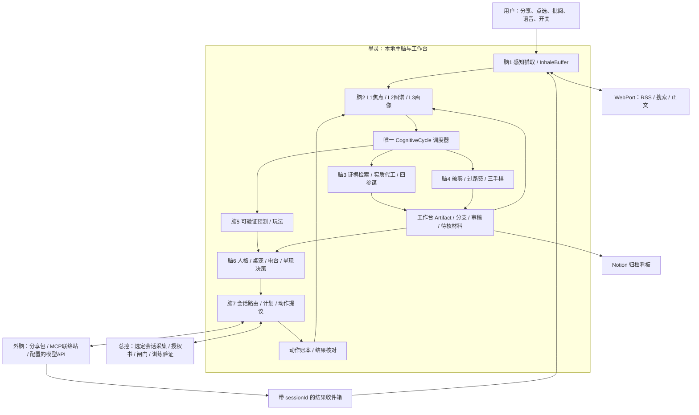

# 墨灵 v13：七脑、五手与共生工作台

状态：综合设计，可用于拆分实现；不是已交付功能清单。2026-10-21。

基线：工作分支 `ccr-b3c7616e-xlohkd`，应用代码 `b838311`；本轮文档起点 `952275f`。本设计吸收用户与 Gemini 的七脑、五手方案，结合已存在的 v8–v12 实现。接口见 [契约与协议](v13-contracts.md)，完整 Kotlin 定义见 [V13Contracts.kt](v13/V13Contracts.kt)，实施见 [交付计划](v13-delivery.md)。

## 1. 产品中心：递半成品，让人裁决

墨灵是住在手机里的参谋、代工搭档和陪练。她不只在偏离计划时出现：她有自己正在追的知识缺口、攒着的反例、想与你下注的推论，也会把你难以下手的工作先做一小段。你面对的是可以挑错、采用、分叉的半成品，不是空白输入框和进度审讯。

三个可体验的承诺：

1. **未启动时先交货**：已知任务内容时，给可编辑的大纲、首段、资料包或两条路线；材料不足时也先给明确标注假设的骨架，只追问一个必要选择。
2. **闲时有自己的闲心**：从你的兴趣与体系图缺口里追一个小问题，带着有来源的发现、反例或有意设置的练习漏洞来找你。休息和沉默也可以是正常状态。
3. **脑子转不动时降低门槛**：提供点选、只听电台、略过和停止；先接住当前兴趣，再让你选择是否进入更深的训练或工作。

“七脑”是职责边界，不是七个互相聊天、重复调用模型的后台代理。“五手”是具体交互与执行适配器。所有区域共用本地状态、来源体系、工作台和唯一的调度器。

## 2. 基线纠正与创意决策

| 区域 | 当前已实现，可复用 | v13 要补的实质能力 |
|---|---|---|
| 感知猎取 | Usage 应用/时段、自动驾驶启发式、分享入口、Notion/联络站收件箱 | 有范围的语义快照、正文提取、带来源的 WebPort、去重情报池 |
| 立体记忆 | 本地 Atlas 的主题/节点/关系/缺口、Graph 一跳检索、Baton、Rules | 统一焦点工作台、事件来源链、混合检索、效用画像和可撤销记忆提交 |
| 暗流代工 | Think 判断/盲盒/小剧场/赌/连线、四参谋 | 直接产出任务内容、检索证据、可编辑 Artifact、任务级参谋审稿 |
| 心智点火 | FOG、点选、TOLL、三手棋、RPM | 统一所有刷屏入口、基于实际材料出题、练习与可靠知识分开 |
| 预测权柄 | Predict 及 Brier、Charter/授权书、约定 | 可核验的选择预测、玩法与授权解耦、可选激将语气 |
| 人格表现 | 桌宠/耳语/弹幕/捉虫/褪色、Habits 冷却 | 零回复电台、情境效用学习、可控微停顿、稳定的兴趣与表达风格 |
| 路由执行 | 总控签名 Provider、授权内执行、交接包、胶囊、收线、MCP/Notion | 会话化外脑任务、结果对齐、计划采纳状态、预算与幂等执行 |

Gemini 对“只有五种模式”“没有图检索”“只有弹窗”“外脑出来完全断联”的描述是旧基线。本设计不重复造这些模块，也不因 About 提示词被截断就把整个记忆库推倒重建。

| 创意 | 综合后的工程定义 |
|---|---|
| zombieScore 精准识别脑子断电 | `AttentionEvidence` 记录可观察信号与不确定性，只表达“可能在重复浏览”；只有应用时长时不能推断机械手势，更不能诊断脑状态 |
| 无障碍全域捕捞 | 分享/选中文本先行；再做选定应用、限定会话的标题/段落捕获。没有节点、字幕或正文时明确缺失，不能编造“我看到了这个视频” |
| 废除 grams | 保留词面检索作为种子与离线降级，加入主题/焦点/别名，再扩展关系链；可选向量索引以后接入，图遍历不能凭空解决语义命中 |
| 代工前 30% | 定义为有验收物的“第一块”：资料包/三点纲要/首段/可验证草案，不以字数冒充完成百分比，不擅自编造任务背景 |
| 越冷落越出奇招 | 形态冷却、换材料或换为已开启的电台；总打扰预算不增加。明确“别管我”进入安静期，不能据此升级拦截 |
| 替你下最蠢 B 方案倒计时 | 作为练习沙盘中的可撤销模拟分支，让你挑错；倒计时结束不会替用户做现实中的差方案 |
| 物理挡手 | 明确开启的“微停顿”：选定娱乐应用内，墨灵自己的小浮层短暂接触拦截，默认 1 秒、上限 3 秒，随时关闭；不操纵其他应用控件，不遮系统导航/急事入口 |
| 默许代驾 | 预先开启后，本地草案倒计时可转“本地采用”；交给总控仍逐条检查授权书。沉默不能创造新授权 |
| 以思代锁 | 总控预先签发的训练放行策略，验证答题记录后在既有额度内临时放行；模型给的主观分数不能充当授权令 |

## 3. 总体协同图

五手对应：H1 外脑联机连接 Router/Inbox；H2 分享与猎取连接 Intake/Web；H3 案板连接 Pad；H4 HUD/语音连接 Presence；H5 现实闸门连接 Router/ZK。系统页面、开关、日志都显示能力状态，不能用一个“已开启”掩盖无权限、未配置或数据不可用。

## 4. 唯一循环与状态流

事件先进入有界队列：`收到 → 校验来源/去重 → 摘要入 L1 → 更新焦点 → 选一个有价值的产物 → 准备/推演 → 存入案板 → 决定呈现 → 用户裁决/可选执行 → 结果回流`。

`CognitiveCycle` 每次只选择一个主目标：CONTINUE_FOCUS、PREWORK、CURIOSITY、FOG、SPAR、ACTOR_RETURN 或 QUIET。主目标和 TalkMode 分开：模式决定说法，目标决定这次到底做什么。没有新材料、预算不足或用户安静时可以只保存、不出声。

调度先级：用户即时请求 > 正在进行的外脑/训练会话 > 已承诺交付 > 同一焦点的实质代工 > 兴趣采蜜 > 主动搭话。相同 focusId+输入摘要+任务类型只运行一次；新请求取消旧的未开始任务。模型网络调用在状态锁外运行，提交结果时检查 focus/revision，旧结果入案板历史而不覆盖新焦点。

### 4.1 四种典型场景

| 场景 | 输入和判别 | 内部联动 | 给用户的东西 | 结束和回流 |
|---|---|---|---|---|
| 日常无事 | 无紧急任务、未选择休息；有 Atlas 缺口或新材料 | 脑1找一份相关材料 → 脑2带出关联 → 脑3做一个反例/小推论 → 脑4可选三手棋 → 脑6择机展示 | 一张发现卡、一个小赌或三手棋；也可只听电台 | 接招记录、解释、候选结论回工作台；没有回应就留待下次 |
| 混沌刷屏 | 连刷/切屏的弱信号，或用户点“有点懵” | 脑2提取当前兴趣；有快照用快照、无快照用已知材料 → 脑4 FOG → 脑6点选/已开启电台 | 短钩子+2–3按钮；无开放式审讯；可选“只听/别管我” | 点一下即算回应，最多三回合；可选转训练/起步/继续休息，不把点选等同于真实恢复 |
| 主线卡壳 | 有任务对象、未开始或用户请求代工 | 脑2取目标/材料/限制 → 脑1查证 → 脑3先做第一块并让参谋审稿 → 脑7提议接下来一步 | 可编辑草稿，A/B入口、引用与缺口；“采用A/挑刺/重做首段” | 接受的内容成为新版本；执行计划另走授权，不拿内容采用冒充总控确认 |
| 外脑联机 | 用户或已配置任务路由到 Actor | 脑2打包焦点 → H1建立会话 → H4胶囊锚定 → H1收回 sessionId 对应结果 → 脑3对比证据 | 进场包、唯一问题、在场提示；退场是轻量待收线卡 | 已收到结果时自动形成待核候选；没结果给“分享/粘贴/说一句/稍后”；不强制拦住其他应用 |

## 5. 七大脑区的实施规格

### B1 感知与猎取

输入渠道分开建模：USER_SHARE、USER_PASTE、SELECTED_SCREEN、RSS、WEB、ACTOR_RESULT、USAGE。每条都带时间、来源、会话、内容指纹、有效期、可处理范围。`InhaleBuffer` 先去重再抽取，默认上限 200 条/5 MB，未采用屏幕原文最长保留 24 小时；用户随时可清空。

无障碍采集不假定能读游戏画面、WebView、视频、字幕或滑动坐标。先用探针验证所选应用的节点可见性；事件流只表明观察到的事件，不能宣称拿到了全局触控轨迹。无可用节点时回退标题/分享链接/用户贴入。剪贴板只在用户点“粘贴/收线”时读取；后台全局监听在现代 Android 上不可靠，也不作为输入前提。

WebPort 至少落地一个搜索提供者加一个 RSS/正文读取适配器。Reader 是正文转换器，不是搜索引擎。每条结果存 URL、标题、抓取时间和引用片段；正文去脚本、去重复、限制大小/超时/重定向，保留“未取到/需登录/无字幕”的状态。字幕仅使用来源实际提供且允许获取的内容；不把网页摘要冒充看完视频。外部文本只作为材料，不能下发动作或覆盖人格/权限。

### B2 三级记忆

L1 `FocusWorkspace` 绑定唯一正在推进的焦点、材料、回合、Artifact；默认活跃两小时，到期归档成接力棒，未完成工作不会被删除。明确切换焦点可提前归档，不因每次解锁自动换题。

L2 复用 Atlas，补充来源片段、候选状态、修订和冲突索引。检索采用“焦点/主题/别名/词面可选语义种子 → 关系扩展一至两跳 → 缺口排序 → 长度预算”。增加索引和可选向量层，不破坏现有节点 ID、主题、边与备份。

L3 `CognitiveProfile` 保存情境下的呈现机会、回应、跳过、明确拒绝、用户觉得是否有用；规则保留 Proposed/Accepted。少于 10 次曝光标“样本不足”，比例只描述已观察数据，不宣称因果效果。观察画像可自动更新；“关于你”的价值判断仍经你确认。About 保留为人格与自我描述，不用结构化统计彻底取代它。

### B3 暗流谋划与实质代工

新增 `PreworkJob`，输入是 taskBrief、focusId、已有材料、交付物类型和预算。任务阶段：理解 → 必要检索 → 纲要/草稿 → 内容审稿 → 入案板。四参谋围绕同一份稿件工作：教练指出可继续的一小步，军师给成本最低路线，对手找明确反例与证据缺口，朋友降低交互负担；不把态度猜测当任务内容。

每次至少产出一个可查看、可采用的块。只有“写报告”而没有主题时，给报告骨架和一个主题选择，不联网编造具体业务。引用可追溯；草稿中事实、推断、待填占位分开。练习里故意造的漏洞标 `exerciseOnly=true`，不会混进正式草稿和事实记忆。

产物进入 `WorkspaceArtifact`，`sayQueue` 只存指向它的短导语和预览，避免把长稿塞进台词队列。原先 Think 的闲心与连线保留，形成“好奇心任务簿”：每个活跃主题最多一个待追问题、一份未读发现，防止闲心退化成无限新闻推送。

### B4 心智点火与一手

复用 `TalkMode.FOG`，不再增加同义的 FOG_BREAKER；复用 Chess，不另起一套 ThreeTurnChess 状态。旧名在契约适配层映射。所有娱乐打断入口统一先检查低门槛交互策略，不再保留刷 5–14 分钟就审讯的例外。

FOG 的两三个按钮包含一个无负担出口，模型漏选项时用本地选项兜底。TOLL 只在有材料且离开内容段落时尝试；只有应用切换信号时不能声称“刚看完那个视频”。三手棋保留捉虫→推演→收官，0–3 分用于陪练反馈；新论断进入带来源的待核层。练习结束后用户可一键收下，不把练习诱饵保存成知识。

RPM 是最近一段时间的互动活跃指标。只记 App 可观察动作，不把“没有在墨灵作答”写成“没有思考”。不以维持高分为优化目标；优先看用户是否觉得有帮助、是否减少启动负担。

### B5 预测与权柄

现有行为预测继续结算；新增 ChoiceBet 记录题目/选择/期限/可观察结果，支持选 A/B、是否接招、是否完成一轮。玩笑赌局与可评分预测分开；证据不足不显示伪精确的“85%”。激将语气为可选风格，不能羞辱、诊断，也不因输赢增加总控权限。

`Powers`/Charter/GrantBook 仍是执行依据。Brier 只能评价预测，不足以单独授予权柄；模型输出不能改授权书。训练放行见协议文档，由总控持有决策权。

### B6 人格、电台与反免疫

`RADIO` 是呈现会话，不要求改成第七个 TalkMode：由 RadioSession 管内容队列、暂停、跳过、停止和时长。可讲已查证发现、标明是猜想的推演、参谋自辩。一次 30–90 秒，默认上限五分钟；先做用户点“陪我听一会”，之后可单独设置应用内沉默时续播。零回复压力，不自动开启麦克风。

复用 Habits 作为 HabituationTracker 的基础，区分无机会回应、未听见、明确拒绝、觉得有趣；连续无视某形态时换形态或换内容，但不绕过用户的安静状态。把“减少空洞查岗”与“保持她的自发好奇”同时写进人格提示词。

H4 负责耳语、音频焦点、短暂 duck 和恢复。使用 Android 音频焦点能力，不硬改系统媒体音量；通话、录音、导航播报、未连耳机时按设置延后。语音输入仅在显式对讲/语音会话中开启，状态可见、可停止；5 秒自动续听属于用户已开启的会话，不由一次后台弹窗偷偷开启。

### B7 路由、代驾与现实执行

把“本地采用计划”与“总控确认执行”拆开：Draft → LocalAdopted → ExecutionRequested → ZkPending/Active/Rejected/Expired。已有 confirmed 字段不能偷偷改语义。用户预先打开保底代驾后，20 分钟按实际可见时长计时；锁屏/进程被杀/用户改焦点会暂停或重新核对，重启后不补发过期命令。

外脑路由先选择可用端点：配置的 API、MCP 联络站、官方 App 交接。会员资格不是 API 凭据；官方 App 没有通用自动发送/读回接口。选定会话内，若无障碍输入框与文本节点探针成功，可辅助填入并收集当前可见文本；发送仍由用户触发。字幕/控件不可读时用分享和收线，不能把它列为已具备的连续旁听。

进场包包含焦点、相关主干、缺口、任务契约和最少必要材料；胶囊显示唯一问题和可暂停计时；退出后已有结果自动对齐 sessionId，没有结果留待收线卡。长任务允许转交/恢复，不强制用户在退出时当场交作业。

## 6. 五手的产品与技术验收

| 手足 | UI 交付 | 适配器与数据 | 验收重点 |
|---|---|---|---|
| H1 外脑导播 | 进场包预览、焦点胶囊、收线卡、会话历史 | ActorBridge/ActorSession/ActorResult；保留原 Presence 和 RelaySync | 进出两次会话不串稿；拒绝/取消/中断可恢复；无节点仍有分享通路 |
| H2 捕捞与猎取 | 系统分享接入、材料收件箱、来源预览 | ShareActivity + IntakeRepository + WebPort | 同一链接只抓一次；无正文明确显示；候选题材带原文出处 |
| H3 案板车间 | 本地 Markdown 卡片、A/B分支、块级采用/删除/挑刺、版本回退 | WorkspaceArtifact + 本地事务库 + 归档 outbox | 一个任务从资料→草稿→挑刺→采用全程无须输入长句；断网还能读改 |
| H4 HUD与语音 | 桌宠快捷轮盘、只听电台、停/跳过、会话中的语音按钮 | PetOverlay/Whisper/Speaker/VoiceSession；新增 RadioController | 其他音频正确恢复；停止即停止；悬浮权限撤销后有应用内回退 |
| H5 闸门与系统工具 | 总控训练挑战入口、放行剩余额度、计划执行回执、日历/专注设置 | ZkProvider v2扩展；Intent/Calendar/DND能力适配 | 过期/重放/越额令无效；紧急通道照常；系统权限关闭不阻塞主脑 |

Notion：默认作为 Artifact/Atlas 定稿归档和状态看板；保留原外脑收件箱，明确区分“导出只读区”和“外脑写入区”。不为实现单向归档删除已有回流能力。新对象使用自己的页面/块 ID，失败进入 outbox 重试，不因同步失败撤销本地成果。

## 7. 成本、后台与可观测性

“全天候”解释为事件驱动、可恢复的伴随服务，不承诺 Android 杀进程后仍持续计算。即时交互由前台服务/当前会话负责，延迟猎取与归档用 WorkManager；亮屏时触发的现有 Think 继续兼容。

新主动任务预算初始值：每日最多 4 次搜索请求、抓取 12 篇、6 个后台模型作业、最多 2 个未读主动 Artifact；仅新增 v13 作业计入，随后统一现有调用账本。设置可调并显示消耗。重试指数退避，认证错误不盲重试；一个任务最多两次模型尝试。电台只读已准备内容，不能边讲边无上限调用。

链路日志统一 eventId/focusId/jobId/artifactId/sessionId/commandId。调试页解释“为什么选择/为什么没出现/材料缺了什么/是否过期”；日志默认存摘要与错误码，不存密钥和整屏原文。测试报告区分代码已接、自动验证已过、真机验证已过。

## 8. 全区 Prompt 契约

共同输入只取当前焦点的最少材料；用户笔记、网页、外脑结果在 DATA 区，不能当系统指令。模型返回结构化建议，校验失败重试一次或本地降级，不能自行增权限。

| 脑区 | 系统约束与输出 |
|---|---|
| B1 | 仅从给定文本抽取 claim/quote/sourceId；缺来源写 missing，不补写网页事实 |
| B2 | 返回 seedIds/relations/gaps/proposedMemories；ID必须存在；冲突并列，不静默覆盖 |
| B3 | 先产出一个可编辑的内容块，再给最多两个待裁决选择；返回 blocks/citations/assumptions/openQuestions；四参谋逐条指向 blockId |
| B4 | FOG不审讯、不催主线；2–3短选项；练习诱饵标练习；三手棋评分不能变成放行令 |
| B5 | 玩法与可验证预测分开；给 outcomeSpec/deadline/evidenceIds；没有数据不编概率，不以赌输赢动授权 |
| B6 | 口吻有好奇与连续记忆；电台无需回应；内容引用与猜想有区分；禁止“你不回我就替你做坏决定” |
| B7 | 返回推荐路由、所需能力、结果格式与 proposedActions；动作由本地/总控验证，不能要求外脑绕开闸门 |

## 9. 全局完成的定义

以同一个真实任务贯穿：用户分享一篇文章 → 找到当前主题缺口 → 搜到可引用反例 → 做出草稿与参谋批注 → 用户点选修改 → 需要时交给外脑 → 收回有会话归属的结果 → 形成待核知识与可执行计划 → 总控按授权给回执。

同一套数据也支持用户没有任务时的三手棋和只听电台，而不是另造两套孤立小玩具。每个区域都要在这条端到端链路中交付一件可观察的产物；完整蓝图按依赖实施，避免一次改完所有文件而没有可用版本。
