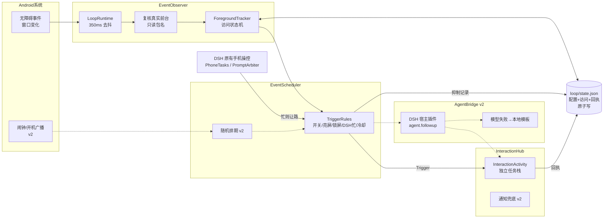

# DSH Go 事件闭环架构

目标：在**不改动 DSH 原有手机操控**的前提下，让手机状态变化能主动触发 DSH。
四个独立模块，共享一个事件结构；第一版只接通 EventObserver → EventScheduler(规则) → InteractionHub，AgentBridge 只定接口。

## 架构图



纯文字版：

```
窗口事件 ─▶ LoopRuntime(去抖 350ms) ─▶ 复核前台包名 ─▶ ForegroundTracker
                                                     │ Entered(新访问)
                                                     ▼
            DSH 忙/锁屏/冷却/有页面未关 ──▶ TriggerRules ──抑制──▶ 回执(SUPPRESSED)
                                                     │ Trigger
                                                     ▼
                                   InteractionHub ─▶ InteractionActivity
                                                     │ 返回/系统返回/离开/超时/没弹出
                                                     ▼
                                           LoopEngine.answer ─▶ state.json
```

## 统一事件结构

所有模块产生、修改的都是同一个 `LoopEvent`（`loop/LoopEvent.kt`，Dart 侧 `lib/loop/loop_channel.dart`）：

| 字段 | 含义 |
|---|---|
| `eventId` | UUID，全局唯一 |
| `source` | `A11Y_WINDOW` / `SCHEDULER`(v2) / `RECOVERY` |
| `timestamp` | 创建时间（墙钟 ms） |
| `state` | `CONFIRMED → TRIGGERED → SHOWN → CLOSED`，只能前进 |
| `result` | 关闭时写一次：`RETURNED` 点返回 / `BACK` 系统返回 / `DISMISSED` 离开页面 / `TIMEOUT` / `ABANDONED` 进程死了 / `UNAVAILABLE` 没弹出来 / `SUPPRESSED` 规则拦下 / `ERROR` |
| `error` | 异常信息 |
| `reason` | 抑制或关闭原因：`cooldown`、`dsh_busy`、`locked`、`process_restart`、`not_shown`… |
| `packageName` / `visitId` / `surface` / `updatedAt` | 前台包名、所属访问、展示方式、最后更新时间 |

持久化（`files/loop/state.json`，临时文件 + fsync + 改名）：配置、访问状态、上次触发时间、最近 200 条事件。**未关闭的事件永不被淘汰**。

## 四个模块

### 1. EventObserver（已实现 v1）
- `LoopRuntime`（Android）：只处理 `TYPE_WINDOW_STATE_CHANGED / TYPE_WINDOWS_CHANGED`；开关关闭时第一行就返回，零开销。
- 去抖 350 ms 后复核：先找获得焦点的应用窗口，再退回 `TreeCapture.foregroundPackage`。**只读包名，不读任何节点内容。**
- `ForegroundTracker`（纯 Kotlin）：一次"访问" = 从别的 App 进入测试 App 到离开。
  - DSH 自己、系统界面、输入法、权限/安装/安全页面都是**透明的**：既不结束访问，也不开始访问。
  - 所以"弹出测试页 → 点返回回到测试 App"、"输入法弹出又收起"都不会被当成新进入 → **没有弹窗循环**。
  - 访问状态落盘：服务重连、进程重启后仍在测试 App 里，不会重复触发。
- `onInterrupt` 不当作断开（只有 `onUnbind/onDestroy` 才 `detach`）。

### 2. EventScheduler（v1 只有规则）
`TriggerRules.decide` —— 顺序即规则：关闭 → 灭屏 → 锁屏 → DSH 忙（有任务、有调用在跑、有问题待答）→ 已有页面未关 → 时钟回拨 → 冷却 → 触发。
冷却用墙钟、跨重启有效；时钟回拨时从"现在"重新计冷却，不会永久卡死。
v2：移植 focusmate `SchedulePolicy`（免打扰、每日上限、用户刚活跃），随机排期 + 闹钟 + 开机/升级重排，全部汇入同一个 `decide`。

### 3. InteractionHub（v1 一个界面）
- `InteractionActivity`：独立 `taskAffinity`、`singleInstance`、不进最近任务。关闭后自然回到测试 App，不碰 DSH 主界面任务栈。
- 由无障碍服务启动（系统豁免后台启动限制）。3 秒内没进入 `SHOWN` → `UNAVAILABLE(not_shown)`。
- 每条出路只关一次事件：按钮 → `RETURNED`，系统返回 → `BACK`，被切走/锁屏 → `DISMISSED`，到时 → `TIMEOUT`。第一条回答生效，其余忽略。
- 进程被杀后系统恢复的页面（`savedInstanceState != null`）直接关闭，不会复活旧事件。
- v2：悬浮层（`TYPE_ACCESSIBILITY_OVERLAY`）和通知兜底；DSH 任务开始时主动收起页面。

### 4. AgentBridge（只定接口，v1 不调用 AI）
```kotlin
interface AgentBridge {
    /** 把真实事件交给 DSH Agent；超时/失败返回 Fallback，由 InteractionHub 用本地模板展示。 */
    fun deliver(event: LoopEvent, context: Map<String, Any?>, timeoutMs: Long): Delivery
    sealed interface Delivery { data class Reply(val text: String) : Delivery; data class Fallback(val reason: String) : Delivery }
}
```
推荐路径：参照 dsh-speak-up，用一个 DSH 宿主插件接收事件，调用 `agent.followup(message)`，让它成为 DSH 自己的回合（人格、记忆、工具照旧）。引擎没运行、模型报错、超时 → `Fallback`，回执记 `reason=agent_fallback`。

## 改动文件清单

新增（Android）：
- `app/android/app/src/main/kotlin/.../loop/LoopEvent.kt` 事件结构
- `.../loop/EventObserver.kt` 包名分类 + 访问状态机（纯 Kotlin）
- `.../loop/EventScheduler.kt` 配置 + 触发规则（纯 Kotlin）
- `.../loop/LoopStore.kt` 原子文件存储（纯 Kotlin）
- `.../loop/LoopEngine.kt` 闭环编排（纯 Kotlin，线程安全）
- `.../loop/LoopRuntime.kt` 无障碍事件去抖、复核前台、环境读取
- `.../loop/InteractionHub.kt` 启动页面 + 3 秒看门狗
- `.../loop/InteractionActivity.kt` 交互页面
- `.../loop/LoopPlugin.kt` Flutter 通道 `dsh/loop`
- `res/values{,-zh}/loop_strings.xml`
- `src/test/.../loop/LoopEngineTest.kt`（17 个用例）

修改（Android，共 +22 行）：
- `phone/a11y/PhoneA11yService.kt`：连接时 `attach`、事件时 `onEvent`、拆除时 `detach`，全部 `runCatching` 包住，出错不影响原服务
- `phone/PhonePrompts.kt`：加只读的 `busy()`
- `MainActivity.kt`：注册 `LoopPlugin`
- `AndroidManifest.xml`：注册 `InteractionActivity`（`exported=false`）

新增/修改（Flutter）：
- `lib/loop/loop_channel.dart`、`lib/ui/phone/loop_test_page.dart`
- `lib/ui/phone/phone_control_screen.dart`：页面最底部加"触发测试"入口
- `lib/l10n/parts/loop_{zh,en}.arb` + 由 `tool/l10n_merge.py` 生成的 arb/gen 文件
- `test/phone/loop_test_page_test.dart`

**没动的**：无障碍配置 XML、权限声明、默认输入法、`SafetyGate`/`ProtectedPages` 规则、`PromptArbiter`、`PhoneTasks`、Agent 工具。

## 技术风险

| # | 风险 | 影响 | 现在的处理 | 后续 |
|---|---|---|---|---|
| 1 | 国产 ROM「后台弹出界面」权限可能拦截无障碍服务启动 Activity | 页面弹不出来 | 3 秒看门狗记 `UNAVAILABLE(not_shown)`，不会卡住后续触发 | v2 用无障碍悬浮层或通知兜底 |
| 2 | 窗口事件很多（`TYPE_WINDOWS_CHANGED`） | 耗电/卡顿 | 开关关闭零开销；350 ms 去抖，每次切换只复核一次 | 真机测功耗 |
| 3 | 分屏、自由窗口、画中画时前台判断 | 误触发/漏触发 | 优先取获得焦点的应用窗口 | 真机覆盖分屏 |
| 4 | 厂商系统界面包名不全 | 下拉通知栏被当成离开 → 回来再触发 | 已含主流厂商 systemui；冷却兜底 | 收集真机包名补表 |
| 5 | 与 Agent 操作抢屏幕 | Agent 打开测试 App 时弹页面 | DSH 有任务/有调用/有问题时一律 `dsh_busy` 抑制 | v2：任务开始时收起已弹出的页面 |
| 6 | 强行停止 App 后无障碍不一定自动重绑 | 闭环停止 | 设置页显示"无障碍已开启/已连接"状态 | 真机验证，必要时提示用户 |
| 7 | 进程死掉期间离开又回到测试 App | 回来时不触发（保守） | 有意为之：宁可漏一次，不重复弹 | — |
| 8 | 每次状态变化同步 fsync（主线程） | 极少量卡顿 | 只在进入/回执时写，低频 | 事件量增大后改后台写 |
| 9 | 隐私与上架政策 | 无障碍用于主动监听 | 默认关闭；只存包名；不读页面内容 | 正式发布前更新无障碍披露文案 |
| 10 | 本环境没有 Android SDK | 完整 APK 未构建 | Kotlin 对 Android API 35 + Flutter embedding 做了编译检查；纯逻辑 JVM 测试通过 | 需在有 SDK 的机器上 `./gradlew assembleDebug` |
