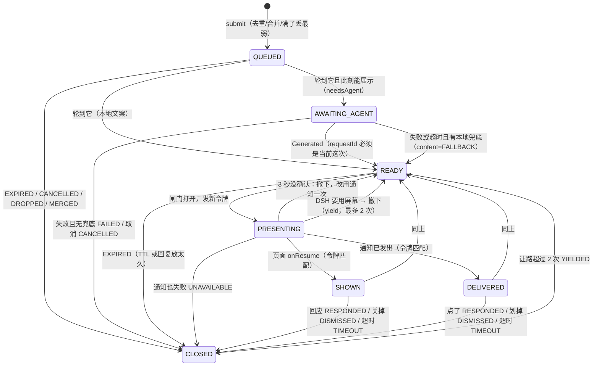
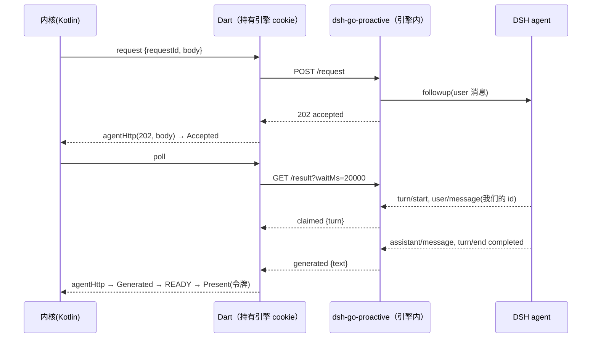

# 第二轮：主动交互协调内核（T4 / T6 / T8）

基线：第一轮 `feat/event-loop-v1`（基于上游 `d38a39a`）。本轮新增两个补丁：

| 补丁 | 内容 | 冲突风险 |
|---|---|---|
| `0002-proactive-kernel` | 纯 Kotlin 内核 `loop/core/`（仲裁、调度、协议编解码、存储）+ 66 个 JVM 测试；DSH 宿主插件 `runtime/proactive/dsh-go-proactive/` + 单元测试 + 真实引擎端到端测试；本文档 | **零**：全是新文件 |
| `0003-proactive-android` | Android 适配 `loop/proactive/`（新文件）+ 共享文件小改：`PhonePrompts`(+5 行只读回调)、`MainActivity`(+1)、`AndroidManifest`(+页面/接收器/开机权限)、`LoopRuntime`(+约 15 行钩子)、字符串 | 低：见集成指南 |

## 1. 链路

```
Android 窗口事件 ─┐                         ┌─ DSH 正在操作手机 / 有确认在等 / 权限页在前 → 让路
随机调度(闹钟) ───┼→ 本地规则 → 入队/合并/丢弃 → 仲裁 ─┤
                  │                         └─ 可以 → 需要 Agent？
                  │                                    ├─ 是 → 宿主插件 → followup → 回合 → 文字
                  │                                    └─ 否 → 本地文案
                  └──────────── 回执 ← 回应 / 超时 / 取消 ← 交互页或通知（令牌）
                     ↓
              调度器按"用户怎么回应的"决定下一次
```

## 2. T4 统一仲裁：`loop/core/Coordinator.kt`

### 状态迁移



进程重启：`AWAITING_AGENT` 保留并用**同一个 requestId** 续查（插件对重放只报告不重发）；`PRESENTING/SHOWN/DELIVERED` 关为 `ABANDONED`，并先清掉残留页面/通知；队列保留。

### 八条要求怎么满足

| 要求 | 做法 | 测试（CoordinatorTest） |
|---|---|---|
| 1 DSH 操作手机时让路 | `Gate.dshTaskActive`（PhoneTasks 活动或有调用在跑）→ 不启动新事件、不调模型；已在屏上的撤下回 READY | aRunningTaskHolds… / yieldingTooOften… |
| 2 审批/权限时不抢占 | `dshPromptOpen`（PromptArbiter 有问题）或 `protectedForeground`（ProtectedPages 包在前台）同样让路 | anOpenDshQuestionOrPermissionPage… |
| 3 多事件排队/合并/丢弃 | 一次只一个在办；队列按优先级再按时间；同 `dedupeKey` 合并（取更高优先级、更晚过期）；满了丢最弱，新的若最弱则直接丢 | twoEventsAtOnce… / sameIntentMerges… / fullQueueDrops… |
| 4 同一 eventId 不执行两次 | 记住最近 512 个 id；重复提交拒绝；插件侧同 requestId 只报告不重发、同 eventId 在途拒绝 | anEventIdRunsOnce… + 插件测试 |
| 5 旧页面/旧回调/过期通知不能回答新事件 | 每次展示一个新令牌；只认当前令牌；被撤下的令牌若再报"已显示"会收到撤下命令 | anEventIdRunsOnce… / aRunningTaskHolds… |
| 6 等模型时被取消，旧结果不再展示 | 每次请求一个新 requestId；不是当前的回复只计数、不改状态；迟到的 Accepted 会再发一次取消 | aReplyForACancelledEvent… / aReplyFromAnOlderAttempt… |
| 7 进程死亡/重连后恢复 | 每次变化落盘（原子写）；见上 | restartResumes… / restartAfterTheAgentDeadline… / unreadableState… |
| 8 不破坏原有操控和安全确认 | 内核**只读** PhoneTasks / PromptArbiter（`Gate`），不拿所有权、不进 PromptArbiter、不走 PhonePrompts；唯一的共享改动是 PhonePrompts 上一个只读通知回调 | — |

时钟回拨：所有截止时间按"剩余时长"平移，不会被拉长；误差最多等于两次调用之间的间隔（内核不知道回拨发生在哪一刻）。

## 3. T6 调度：`loop/core/ProactiveScheduler.kt`

- **随机只在排期**：`plan()` 在 [min, max] 里随机取间隔；`evaluate()` 是确定的，同样的状态和时钟永远给同样的答案。
- 判定顺序：关闭 → 连续被忽略暂停 → 已有尝试在办 → 免打扰 → 今日上限 → 还没到 → 用户刚活跃 → 触发。
- 触发产生的是一个 `EventRequest`（`needsAgent=true`、**没有本地兜底文案**：Agent 不可用就不说话，不伪造），照样经过仲裁所有闸门。
- 回执决定下一次：

| 回执（Engagement） | 计入今日次数 | 被忽略计数 | 下一次 |
|---|---|---|---|
| RESPONDED / DISMISSED | 是 | 清零、解除暂停 | 正常随机间隔 |
| IGNORED_SEEN（页面确认显示过、没回应） | 是 | +1；到 3 次暂停到用户再出现 | 间隔 × 2^次数（上限 ×8） |
| UNCONFIRMED（通知发了但不知道看没看） | 是 | 不变 | 正常间隔 |
| NOT_DELIVERED（没展示出来） | 否 | 不变 | 10–15 分钟后重试，连续 2 次后恢复正常间隔 |

- 用户活跃（发消息、回应）：清零并至少推后 20 分钟。
- 时间：同一次开机内用 `elapsedRealtime` 判断"到没到"，改墙上时间既不会提前也不会推迟；免打扰和"今天"用墙上时间；日期往回调**不会**清零今日次数；重启后墙上时间离谱（远在未来）或关机错过太久都重新排期；在办尝试丢了回执会在恢复时释放。
- 唤醒（`WakeMode`）：能用精确闹钟就设一个精确闹钟；不能就设一个不精确的（只会晚、不会早）；系统限制后台时**不设闹钟**，只在打开 DSH 或无障碍看到窗口切换时顺带检查（每分钟最多一次）。没有任何循环。

测试：ProactiveSchedulerTest 17 项，覆盖随机范围、确定性、免打扰、上限只算投递、用户活跃、连续两次确认无回应（×4）和第三次暂停、通知未确认不惩罚、未送达重试、改时钟、改日期、重启、重启后时钟跳变/长时间关机、丢失的在办尝试、关闭、降级。

## 4. T8 Agent 协议



六个环节分开记录（`ProactiveEvent` 上的独立时间戳）：

| 环节 | 字段 | 由谁证明 |
|---|---|---|
| Agent 已接受 | `agentAcceptedAt` | 插件 202：消息在收件箱 |
| （回合已开始） | `agentClaimedAt` | 插件 claimed：`user/message` 写入日志 |
| 模型生成成功 | `generatedAt` | 插件 generated：回合 completed 且有可见文本 |
| 消息成功投递 | `deliveredAt` | 页面已启动 / 通知已发出 |
| 界面确实展示 | `shownAt` | 页面 onResume；**通知永远不能单方面声称"已展示"**，只有用户点它或划掉才算 |
| 用户主动回应 | `respondedAt` | 页面按钮 / 通知按钮（令牌匹配） |
| 未回应或取消 | `outcome` TIMEOUT / DISMISSED / CANCELLED | — |

DSH 现有 API **不支持**的环节和最小适配：

| 缺口 | 现状 | 本轮的最小方案 |
|---|---|---|
| followup 没有回执 | rc.4 里 `followup()` 同步、无返回值；不会告诉你何时开始、何时结束 | 插件按消息 id 监听 `user/message` 和 `turn/end` 自己推出状态 |
| 不能撤回已认领的消息 | `agent.cancel()` 会清空整个收件箱并中止当前回合 | 取消只作废结果，**不中止**回合；文档明确写出 |
| 不能以非 user 角色送入 | developer 角色会让回合报错 | 用 user 消息 + 文字框住"这不是用户说的" |
| 插件不能新建/唤醒会话（设计选择） | `sessionController.create()` 可以建，但会凭空多出会话 | 只投给已配置、活着、空闲的会话；否则 409，App 不展示任何东西 |
| 记录不持久 | 插件记录在内存 | 插件重启后查询 404 → App 记 `lost`，事件按失败处理 |
| 模型可能仍调用工具 | 提示里要求不调用，但没法强制 | 若它真的动手机，PhoneTasks 变活跃，内核让路；列为审查问题 |

真实验证（本沙箱，2026-10-30）：按 dsh-go 锁文件装了 `@deepseek-ai/dsh@0.2.1-rc.4`，`dsh web` 加载本插件，模型接本地 Messages API 假服务。`test/e2e-live.mjs` **26/26 通过**：鉴权 401、无会话、不唤醒不存在的会话、真实 followup → 认领到回合 1 → 生成的文字确实是模型返回的那句、同 requestId 重放不再调模型、requestId 冲突、同 eventId 在途、本插件忙、**用户自己正在和 agent 对话时 agent-busy**、回合进行中取消且回合结束后的文字不交出、截止时间到判失败。插件纯逻辑测试 10/10。

## 5. 测试一览

| 层 | 命令 | 结果 |
|---|---|---|
| 内核 JVM（含第一轮 17） | kotlinc + JUnit 4.13.2 | 66/66 |
| 其中 12 个指定场景 | 见下表 | 全部覆盖 |
| 插件纯逻辑 | `node --test test/core.test.mjs` | 10/10 |
| 插件 × 真实 DSH 引擎 | `node test/e2e-live.mjs …` | 26/26 |
| Android 适配编译检查 | kotlinc 对 Robolectric android-all（API 35）+ Flutter embedding；DSH 内部类用照抄签名的桩 | 通过（≠ Gradle 构建） |

| # | 场景 | 测试 |
|---|---|---|
| 1 | 同时触发两个事件 | Coordinator: twoEventsAtOnce…, waitingEventsAreOrdered…, sameIntentMerges…, fullQueueDrops… |
| 2 | 任务进行中收到主动事件 | aRunningTaskHolds…, yieldingTooOften…, KernelChain: …WaitsForDsh… |
| 3 | 用户正在审批权限 | anOpenDshQuestionOrPermissionPage… |
| 4 | Agent 请求超时 | agentTimeoutCancels…, agentFailureWithoutFallback…, 插件 deadline（真实引擎） |
| 5 | 响应回来时事件已取消 | aReplyForACancelledEvent…, aReplyFromAnOlderAttempt…, 插件 cancel（真实引擎） |
| 6 | 进程重启后恢复调度 | restartResumes…, Scheduler: restartKeepsThePlan…, aLostPendingAttempt…, KernelChain: processDeathMidTurn… |
| 7 | 系统时间变化 | clockGoingBack…, movingTheWallClock…, settingTheDateBack…, rebootWithAJumpedClock… |
| 8 | 通知已发出但没看见 | aPostedNotificationThatTimesOut…, unconfirmedDelivery… |
| 9 | 连续两次确认投递无人回应 | ignoredMessagesWidenTheGapAndThenPause |
| 10 | 无障碍断开 | withoutAccessibilityPagesBecomeNotifications… |
| 11 | 用户关闭主动功能 | switchingOffCancelsEverything…, switchingOffWithAPageUp…, disabledSchedulerNeverFires… |
| 12 | 重复回执和过期按钮 | anEventIdRunsOnce…, pendingAttemptBlocks…（重复回执被忽略）, 插件 replay |

## 6. 边界

**已实现并有测试**：仲裁状态机、调度纯逻辑、协议编解码、宿主插件（真实引擎验证）。

**已实现、只做了编译检查**：`loop/proactive/` Android 适配（Gate 读取、命令执行、令牌页面、闹钟与开机接收器、`dsh/proactive` 通道）。

**未实现（交给 DeepSeek，见集成指南）**：Dart 侧 HTTP 转发、通知界面（`NotificationPort`）、设置页、把第一轮"打开测试 APP"事件改走内核、插件随 runtime 打包。

**NOT_TESTED（没有真机证据）**：所有 Android 行为——无障碍服务启动页面是否被国产 ROM 拦截、闹钟在省电策略下是否送达、开机广播、强行停止后的恢复、PhoneTasks / PromptArbiter 回调在真实任务中的时序、页面在锁屏/灭屏时的生命周期、Gradle 构建。真实 DeepSeek 模型（只用了假模型）。远程主机（SSH/中转）上的插件。

## 7. 下一轮请 Claude 审查

1. `PhonePrompts.onBusyChanged` 回调放在 `schedule()` 和 `onFinished` 里，是否覆盖所有提问入口（`NotificationGate.ask` 旧路径在 promptGate 为空时不经过它）。
2. `Gate.dshTaskActive` 用 `tasks.isActive || callsInFlight > 0`：任务空闲 3 分钟才结束，期间主动交互一直被压住，是否需要更细的"Agent 正在动手机"信号。
3. Agent 在主动回合里如果仍然调用手机工具：要不要在插件里用 `agent/pre-step` 拦截工具，或者给这类回合单独的无工具预设。
4. 插件记录只在内存：是否值得持久化，还是接受"插件重启 = 本次失败"。
5. 取消不中止回合：是否需要"只有本插件发起且尚未产出可见文字时才中止"的窄路径。
6. 目标会话的选择：现在要用户指定一个；是否需要"最近活跃且空闲的根会话"自动选择，以及它的隐私含义。
7. `ProactivePageActivity` 与第一轮 `InteractionActivity` 是否合并成一个令牌化页面。
8. 时钟回拨误差（≤ 两次调用间隔）是否可接受，还是截止时间改用 elapsedRealtime + 重启校正。
