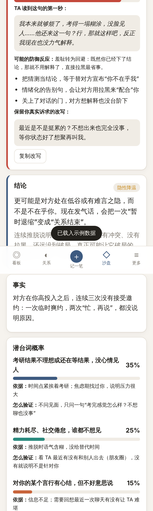
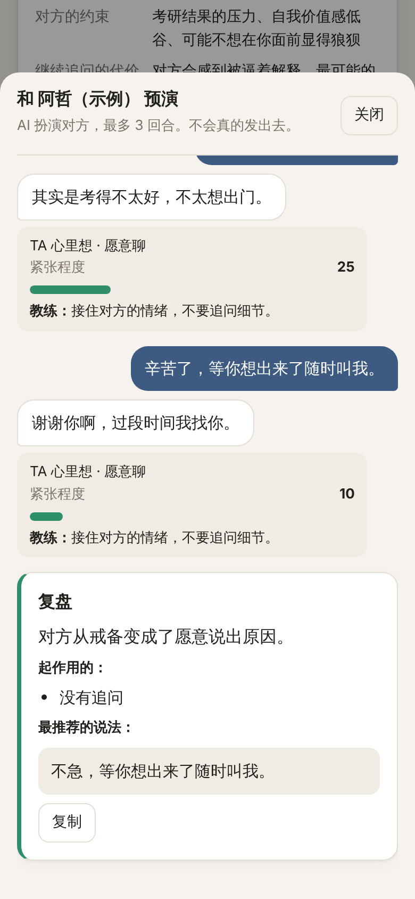
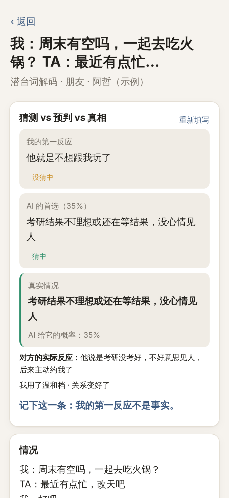
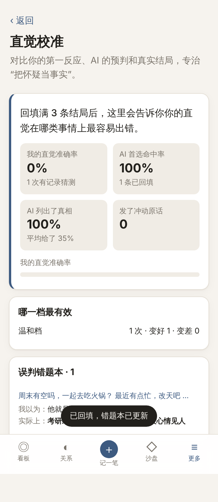
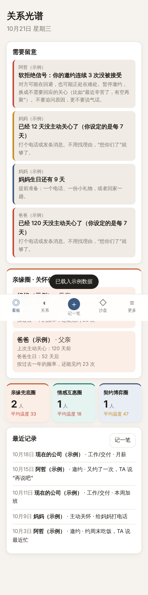
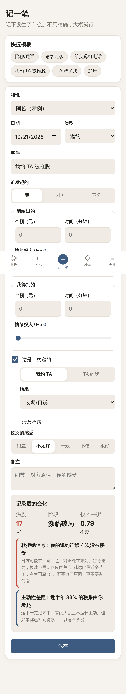
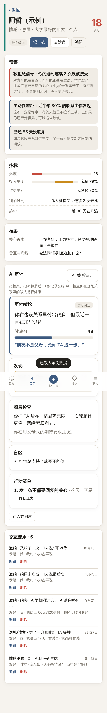
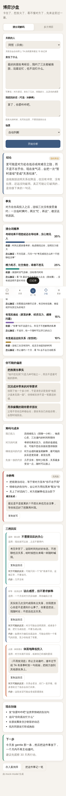

# 关系光谱

一个帮你看清人际关系和利益博弈的 App。它不是记账本，也不教人算计。

- **冲动原话破坏力测试**：想发火时，先把想发的话放进来。AI 模拟对方读到这句话第一秒的反应，给出 0–100% 的翻脸风险，再给三档替代话术
- **潜台词解码**：对方推脱、冷淡、话里有话时，列出几种可能的解释和概率，告诉你怎么低成本验证
- **博弈拆解**：老板画饼、导师卡人、房东扣押金、相亲拉扯，拆出各方的真实诉求、筹码和底牌
- **3 回合对线预演**：选一档话术，AI 扮演对方回你，最多 3 回合，最后给复盘
- **直觉校准**：事后回填真实结局，对比「我的第一反应 vs AI 预判 vs 真相」，生成误判错题本
- **粘贴聊天记录一键解析**：把微信对话或口述的大白话贴进来，自动填好记录表单（没有 Key 时用本地规则）
- **关系提醒**：父母的生日和关怀倒计时，朋友的软拒绝信号，单向付出预警
- **15 个参考案例**：朋友、父母、职场、校园、租房消费、婚恋

设计思路和算法见 [docs/DESIGN.md](docs/DESIGN.md)。

| 破坏力测试 | 对线预演 | 回填结局 | 直觉校准 |
|---|---|---|---|
|  |  |  |  |

| 看板 | 记一笔 | 关系详情 | 博弈沙盘 |
|---|---|---|---|
|  |  |  |  |

## 快速开始（电脑）

需要 Node.js 18 或更高版本。

```bash
cd relation-spectrum
npm install
cp .env.example .env    # 填上 ANTHROPIC_API_KEY（也可以稍后在网页“设置”里填）
npm start
```

打开 http://127.0.0.1:8787。第一次打开可以点“先看看示例数据”。

## 在手机上用

有两种方式：

**1. 手机单独用，不需要开电脑**

把 `web/` 文件夹放到任意一个静态网站托管上（Netlify、Vercel、Cloudflare Pages，或者 GitHub Pages），用手机打开。然后：

1. 设置 → AI 模型 → 连接方式选“自动”或“浏览器直连”
2. 填 Claude API Key（或者一个允许浏览器直连的 OpenAI 兼容接口，如 OpenRouter、DeepSeek）
3. 浏览器菜单里选“添加到主屏幕”

App 会缓存到手机里，没网也能打开、记录和查看；AI 分析需要联网。数据存在手机浏览器里，回家后连上电脑的服务器再同步到 Notion。

> 浏览器直连时，API Key 保存在这台手机的浏览器里。只在自己的设备上这样用，不要把带 Key 的页面给别人。

**2. 手机连电脑上的服务器**

在 `.env` 里设置 `HOST=0.0.0.0` 和 `ACCESS_TOKEN=随便一串口令`，手机和电脑连同一个 Wi-Fi，打开 `http://电脑的IP:8787`，在设置页填同样的口令。这种方式下 Key 可以只放在电脑上。

## 连接方式

| 设置 | 行为 |
|---|---|
| 自动（默认） | 电脑上的服务器开着就走服务器；连不上时自动改为浏览器直连 |
| 只走服务器 | Key 只放在电脑的 `.env` 里；服务器没开时 AI 不可用 |
| 浏览器直连 | 一律从浏览器直接调用大模型 |

Notion 同步始终需要服务器，因为 Notion 不允许浏览器直接调用它的接口。

## 大模型

| 服务商 | 配置 |
|---|---|
| Claude（默认） | `ANTHROPIC_API_KEY`，模型默认 `claude-opus-5-5`，可改成 `claude-sonnet-5-5` 或 `claude-haiku-5-5` 省钱 |
| OpenAI 兼容（DeepSeek、Kimi、通义、OpenRouter 等） | `LLM_PROVIDER=openai`，再填 `OPENAI_API_KEY`、`OPENAI_BASE_URL`、`OPENAI_MODEL` |

Claude 用结构化输出保证返回合法 JSON，并开启了拒答时自动换模型重试（`fallbacks: "default"`）。聊天解析和对线预演用低思考深度，速度更快。

## Notion 同步（可选）

1. 在 https://www.notion.so/my-integrations 新建一个 Integration，复制 Token
2. 在 Notion 里建一个空页面，右上角菜单 → 连接 → 选你的 Integration
3. 在 App 的设置页填 Token 和这个页面的链接，点“一键创建三张表”，再点“立即同步”

也可以用命令行建表：`npm run notion:init`（需要在 `.env` 里填 `NOTION_TOKEN` 和 `NOTION_PARENT_PAGE_ID`）。

同步是双向的：先拉取 Notion 上的改动，再推送本地改动；两边都改过的记录，以后改的为准。v1 建的案例库表会在第一次同步时自动补上“我当时的猜测”“真实结局”等新字段。在 Notion 里删除的页面不会删掉本地记录。

## 目录

```
server/
  server.js         本地服务器：网页、/api/analyze、Notion 转发
  llm.js            Claude（官方 SDK）/ OpenAI 兼容接口
  notion-init.js    命令行建 Notion 表
web/
  sw.js             离线缓存（PWA）
  js/core/
    models.js         数据结构和枚举
    scoring.js        关系温度、失衡度、预警算法
    prompts.js        五个 AI 引擎的提示词和 JSON Schema
    llm-request.js    服务器和浏览器直连共用的请求构造
    parse-local.js    聊天记录的本地解析规则
    calibration.js    直觉校准统计
    notion-schema.js  Notion 字段定义和映射
  js/store/db.js      IndexedDB 本地存储
  js/services/        AI 调用（含直连降级）、Notion 同步、设置
  js/views/           各个页面、对线预演窗口、聊天解析框
  js/data/            示例数据和 15 个参考案例
test/
  core.test.js        算法、提示词、Notion 映射
  v2.test.js          参考案例结构、本地解析、直觉校准、对线预演、直连请求、离线缓存
```

## 测试

```bash
npm test
```

## 隐私

数据默认只存在浏览器里。做 AI 分析时，只会把你选中的那个人的档案、最近 10 条记录和你最近 5 条误判记录发给大模型。建议给真人起代号。
